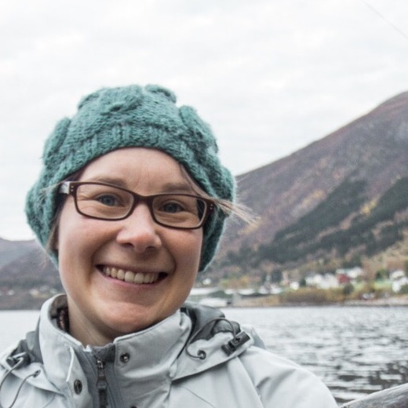
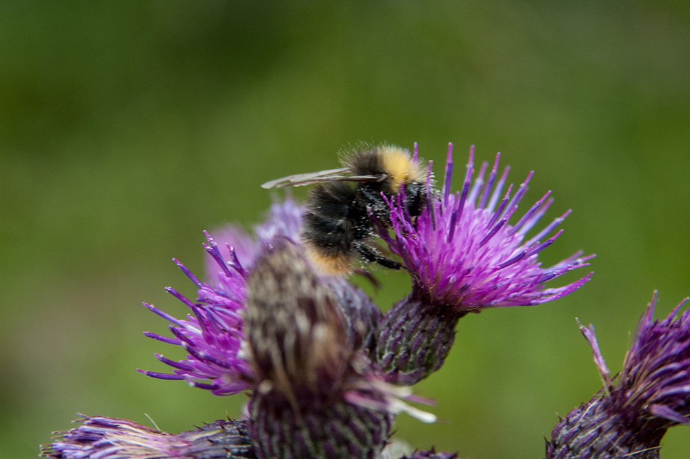
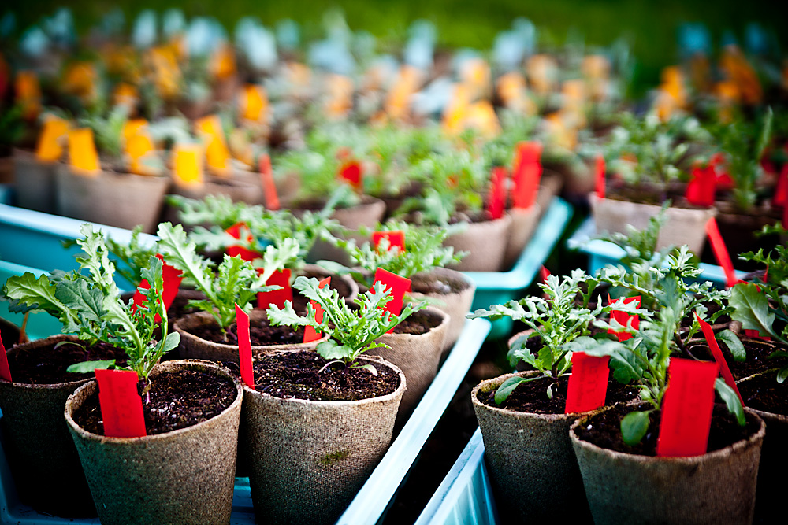

::: {.home-hero}

::: {.home-hero-text}
# Aud H. Halbritter {.home-name}

::: {.home-role}
Plant ecologist, University of Bergen
:::
:::

:::

::: {.home-bio}
I am a plant ecologist working on global-change impacts on biodiversity and ecosystem functioning, mainly in alpine and arctic ecosystems.
To get at the processes behind plant population, community, and ecosystem responses, and at how those responses depend on context, I replicate experiments along broad environmental gradients.
I use trait-based approaches, including intraspecific trait variation, and I use synthesis (meta-analysis and systematic reviews) to look for mechanisms and broad-scale patterns.
More recently I have expanded my research towards applied ecology, through being a contributing author on the IPBES report on alien species and the development of ecological indicators for assessing ecosystem conditions.
Another main research interst is Open Science practices and methodological development in ecology, where I develope tools for reproducible workflows and quantitative analysis, and designing a PhD course on Open Science.
:::

::: {layout-ncol="2"}

:::

## Contact

::: {.contact-block}
[Between the Fjords Research Lab](https://betweenthefjords.w.uib.no/home/)\
[Terrestrial Ecology Research Group](https://www4.uib.no/en/research/research-groups/terrestrial-ecology)\
[Department of Biological Sciences](https://www4.uib.no/en/faculty-of-science-and-technology/department-of-biological-sciences),\
University of Bergen\
Postboks 7803\
5020 Bergen\
Norway

[aud.halbritter [at] uib.no](#){.email-guard data-user="aud.halbritter" data-domain="uib.no"}

[GitHub](https://github.com/audhalbritter) · ORCID [0000-0003-2597-6328](https://orcid.org/0000-0003-2597-6328)
:::
