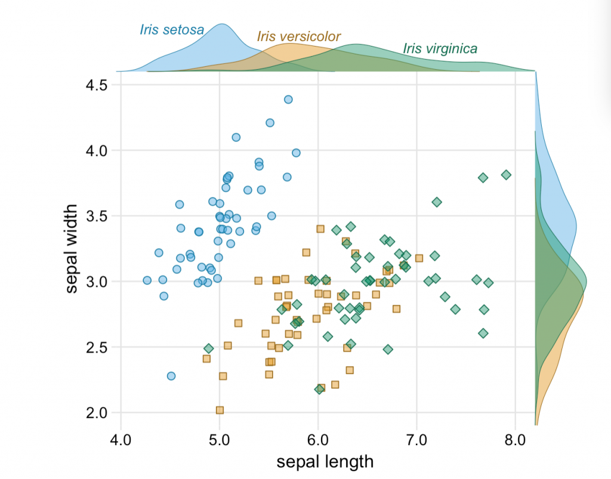
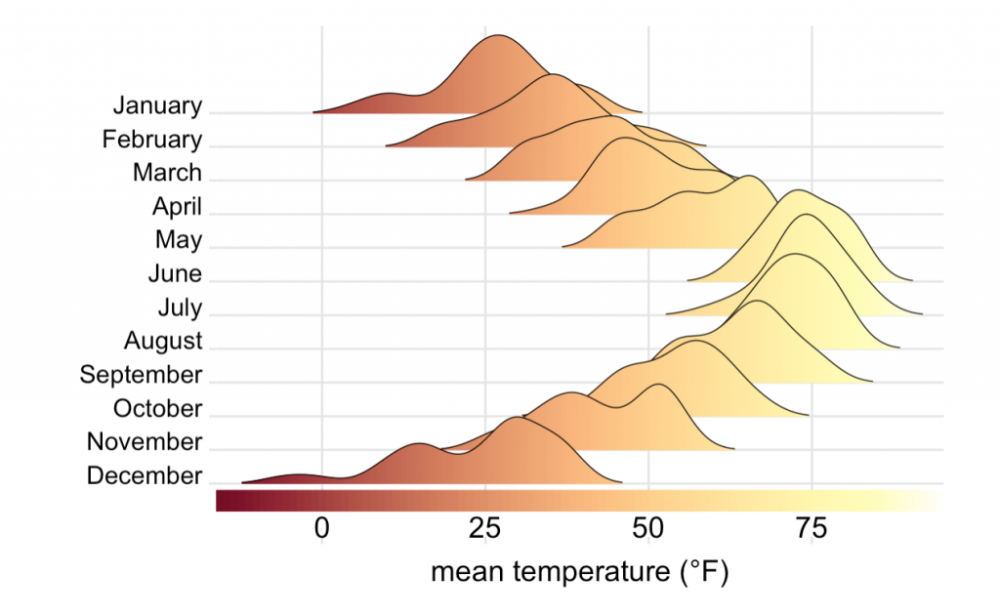

This is a great guide to [fundamentals of data visualization](http://serialmentor.com/dataviz/index.html) by Claus O. Wilkes. It explains general principles and concepts for preparing figures. It’s not an R book, but all the code to make the figures. is available on git.
