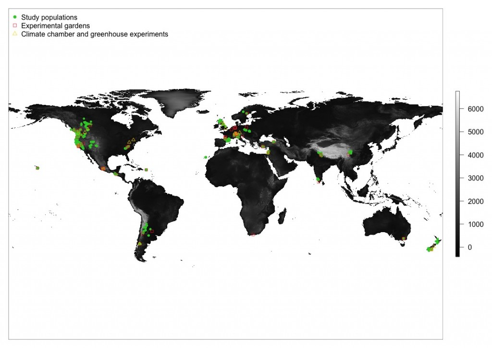
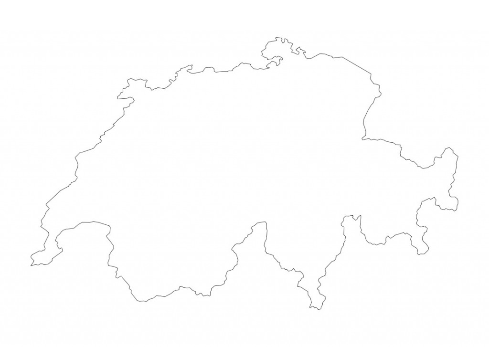

I belive that every ecological publication of a study needs a map. It does not necessarily need to be in the paper but at least in the appendix. I admit, I like maps and could look at maps for infinity, but maps also illustrate where a study was done, the scale of the study and where populations were collected, the range of the study species or locations of the study can be visualized.

Making maps is very easy with R. With a few lines of code you can produce a map of any region in the world and then plot points on the map.

Here, I produced a world map using the [worldclim](http://www.worldclim.org/) elevation data as background and plotted populations and study sites on the map. I used [raster package](https://cran.r-project.org/web/packages/raster/raster.pdf), which is a powerful tool to process spatial data.

This is the R code I used for the map:

> install.packages(„raster“)  
> library(raster)  
> climate \<- getData(‚worldclim‘, var=’alt‘, res=2.5) \# download elevation data from worldclim
>
> plot(climate\$alt, axes=FALSE, col = grey(0:100/100)) \# plot world map  
> points(dat.pop\$long.pop, dat.pop\$lat.pop, col=“limegreen“, pch=16, cex=0.7) \# plot populations  
> points(dat.site\$longitude_site, dat.site\$latitude_site, col=ifelse(dat.site\$studysite==“Garden“,“firebrick1″, „gold1″), pch=ifelse(dat.site\$studysite==“Garden“,0,2), cex=0.8) \# plot sites  
> legend(„topleft“, c(„Study populations“, „Experimental gardens“, „Climate chamber and greenhouse experiments“), pch=c(16, 0,2), col=c(„limegreen“, „firebrick1“, „gold1″), bty=“n“)

 

Other powerful packages to draw maps are maps and mapdata. To plot maps there is a simple command „map“. And by adding a country or a list of countries only parts of the world are plotted.

> library(maps); library(mapdata)  
> map(‚worldHires‘) \# the world  
> map(‚worldHires‘,’Switzerland‘) \# Switzerland  
> map(‚worldHires‘, c(‚Norway‘, ‚Sweden‘, ‚Finland‘,’Denmark‘, ‚Island‘), xlim=c(-11,50), ylim=c(45,90)) \# Scandinavia

 

