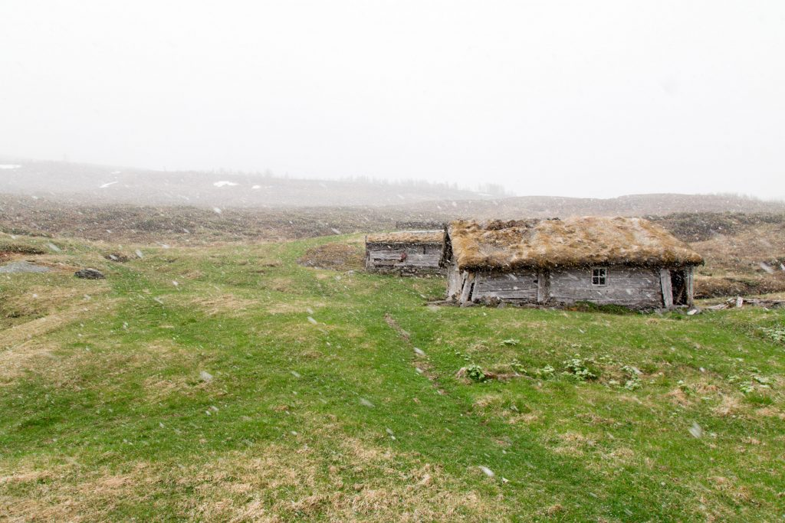
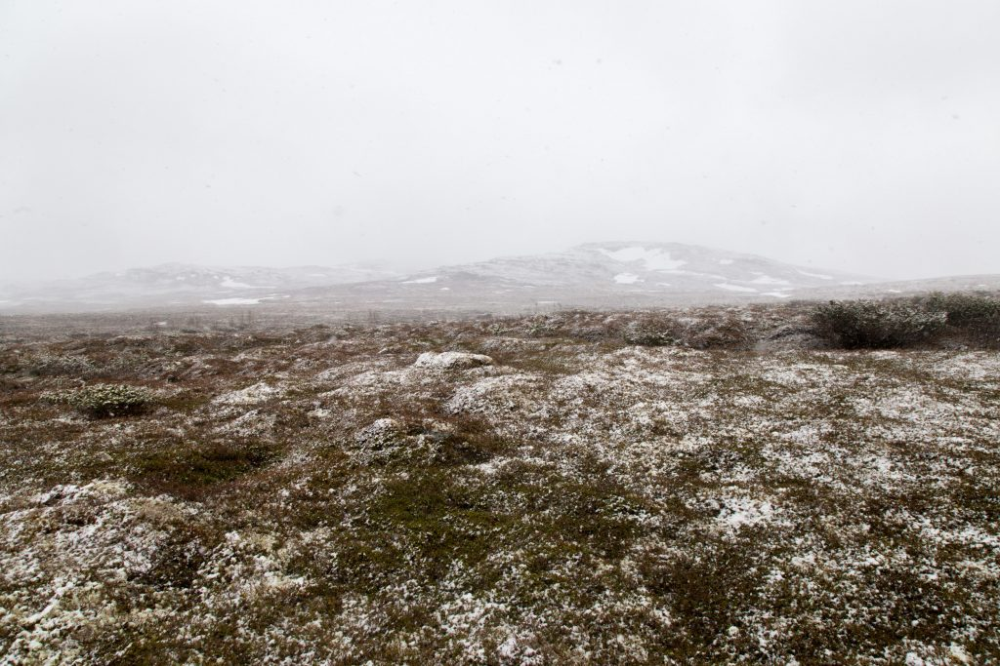
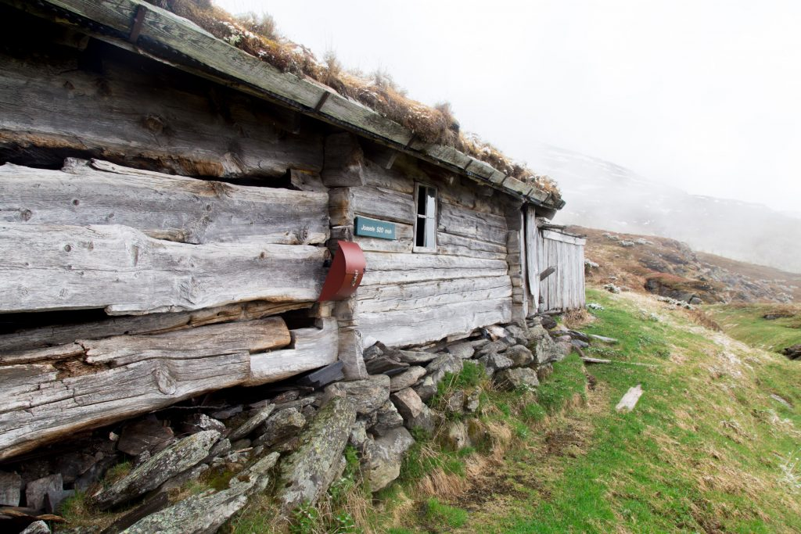
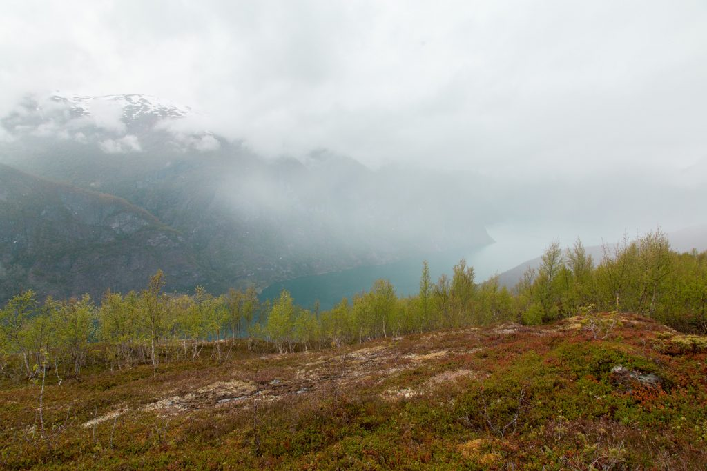

This week, I was in the field to train two students and find potential new field sites. The training was successfully done in decent weather, a mix of sun and clouds. But when we started to walk up the mountain, the snow came. It was snowing and hailing and raining, all in one.

We found a beautiful summer farm, where I will have one of my field sites. It even has a letter box, where hikers can write their names when walking up the mountain.

I’ll have to come back to select the sites properly, set up plots. And then I will spend a lot of time staring at the plants. Looking forward to this!

<figure class="wp-block-image">

</figure>

<figure class="wp-block-image">

</figure>

<figure class="wp-block-image">

</figure>

<figure class="wp-block-image">

</figure>
