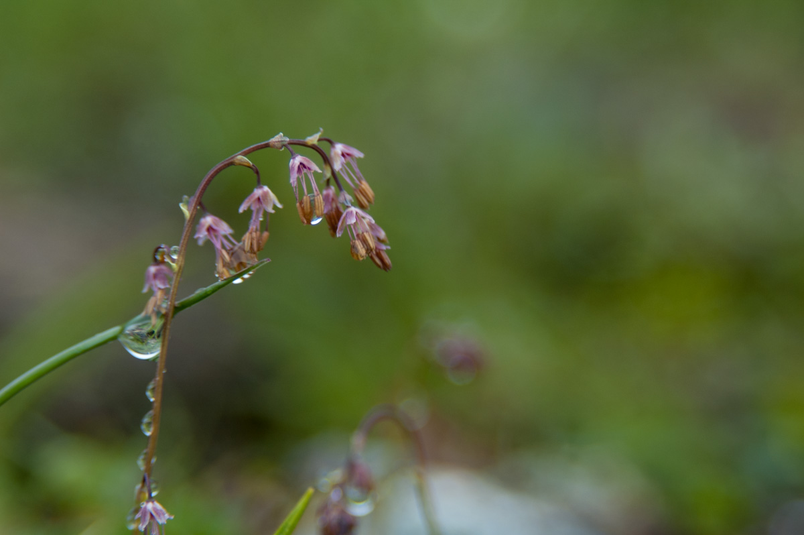

Biotic and abiotic factors are important drivers for species community composition. But how important are they along environmental gradients and between functional groups?

To answer this question, a study was conducted in the [SeedClim](/seedclim-large-scale-climate-change-experiment-in-the-western-norwegian-fjords/) grid in south-western Norway, consisting of a temperature and precipitation gradient. At each of the 12 sites, the vegetation as well as biotic and abiotic factors were assessed.

Both biotic and abiotic factors were important drivers, but explained the species composition at different ends of the gradient. The biotic factors tended to be more important at low elevation (competition), while the abiotic factors explained more at higher elevation (facilitation).

The study also found that graminoids thrive better in wetter climate compared to forbs. In the future with a warmer and wetter climate, graminoids might benefit and forbs could potentially decline due to competition from increasing abundances of graminoids.

The article was published in PlosOne in 2015 and the abstract and full article can be read [here](http://journals.plos.org/plosone/article?id=10.1371/journal.pone.0130205).

 

