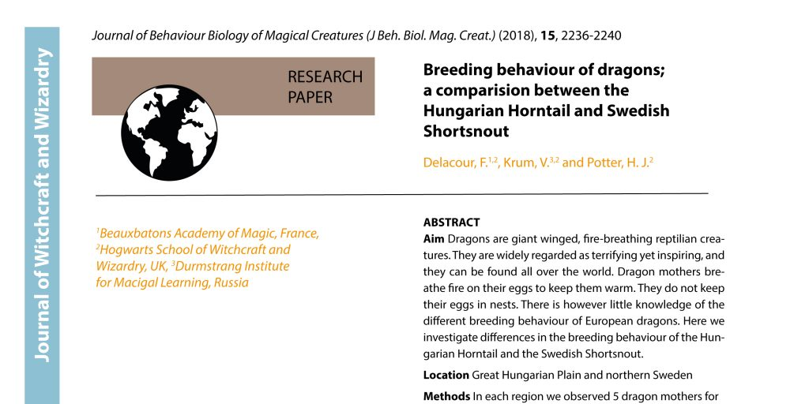

“Everything is possible in R”

[](media/Authors-and-affiliations-1.jpg)

This might not be an everyday problem, but doing this task by hand would take forever. And when finished, I would have to start all over again, because of a tiny litte change. I realized, R code is the only solution!

Here is the problem: I am writing a paper with 109 authors. This is a challenging task in itself. But a couple of days ago I realized writing the author list and their affiliations, arranged by the authors last name and numbered affiliations would be a very tedious task. And as soon as it was done, one of the author would tell me about a new affiliation and another one that this affiliation was old and so on. It did not need a lot of persuasion before I opened R and started to type.

Lets assume we have three authors (we keep it simple for now). We will also need to load the tidyverse library, which is not shown here.

``` r
# Make a data frame with 4 columns
dat <- data.frame(FirstName = c("Harry James", "Fleur", "Viktor"),
           LastName = c("Potter", "Delacour", "Krum"),
           Affiliation1 = c("Hogwarts School of Witchcraft and Wizardry, UK", "Beauxbatons Academy of Magic, France", "Durmstrang Institute for Macigal Learning, Russia"),
           Affiliation2 = c(NA, "Hogwarts School of Witchcraft and Wizardry, UK", "Hogwarts School of Witchcraft and Wizardry, UK"))
dat 
```

    ##     FirstName LastName                                      Affiliation1
    ## 1 Harry James   Potter    Hogwarts School of Witchcraft and Wizardry, UK
    ## 2       Fleur Delacour              Beauxbatons Academy of Magic, France
    ## 3      Viktor     Krum Durmstrang Institute for Macigal Learning, Russia
    ##                                     Affiliation2
    ## 1                                           <NA>
    ## 2 Hogwarts School of Witchcraft and Wizardry, UK
    ## 3 Hogwarts School of Witchcraft and Wizardry, UK

The next step is to prepare the table for what we want to do. Here you can rename columns, filter the table, rearange it etc. For this table we only want to merge the 2 columns containing the affiliations into a single column. We will use “gather” for this.

``` r
# Prepare data
dat <- dat %>% 
  # gather all affiliations in one column
  gather(key = Number, value = Affiliation, Affiliation1,  Affiliation2) %>%
  # remove rows with no Affiliations
  filter(!is.na(Affiliation))
```

Then we need to do the following:

- Arrange the column by last name
- Extract the initials and add a dot at the end of each letter
- Add a column ID to the data frame from 1 to n
- Then we replace the ID in rows with the same affiliation with the lowest ID number
- The previous step might have left some gaps in that we could have ID 1, 3 and 4. So the next step is to change the IDs to 1, 2 and 3. For this we use the little function rankID
- Finally, we paste the last and initials

``` r
# Function to get affiliations ranked from 1 to n (this function was found on Stack Overflow)
rankID <- function(x){
  su=sort(unique(x))
  for (i in 1:length(su)) x[x==su[i]] = i
  return(x)
}

NameAffList <- dat %>% 
  arrange(LastName, Affiliation) %>% 
  rowwise() %>% 
  # extract the first letter of each first name and put a dot after each letter
  mutate(
    Initials = paste(stringi::stri_extract_all(regex = "\\b([[:alpha:]])", str = FirstName, simplify = TRUE), collapse = ". "),
    Initials = paste0(Initials, ".")) %>%
  ungroup() %>% 
  # add a column from 1 to n
  mutate(ID = 1:n()) %>%
  group_by(Affiliation) %>% 
  # replace ID with min number (same affiliations become the same number)
  mutate(ID = min(ID)) %>% 
  ungroup() %>% 
  # use function above to assign new ID from 1 to n
  mutate(ID = rankID(ID)) %>%
  #Paste Last and Initials
  mutate(name = paste0(LastName, ", ", Initials)) 
```

The last thing we need to do is to print a list with all the names + IDs and one with all the affiliations + IDs.

``` r
# Create a list with all names
NameAffList %>%   
  group_by(LastName, name) %>% 
  summarise(affs = paste(ID, collapse = ",")) %>% 
  mutate(
    affs = paste0("^", affs, "^"),
    nameID = paste0(name, affs)     
         ) %>% 
  pull(nameID) %>% 
  paste(collapse = ", ")
```

    ## [1] "Delacour, F.^1,2^, Krum, V.^3,2^, Potter, H. J.^2^"

``` r
# Create a list with all Affiliations
NameAffList %>% 
  distinct(ID, Affiliation) %>% 
  arrange(ID) %>% 
  mutate(ID = paste0("^", ID, "^")) %>% 
  mutate(Affiliation2 = paste(ID, Affiliation, sep = "")) %>% 
  pull(Affiliation2) %>% 
  paste(collapse = ", ")
```

    ## [1] "^1^Beauxbatons Academy of Magic, France, ^2^Hogwarts School of Witchcraft and Wizardry, UK, ^3^Durmstrang Institute for Macigal Learning, Russia"

Et voilà! Names and affiliations:

Delacour, F.<sup>1,2</sup> Krum, V.<sup>3,2</sup> Potter, H. J.<sup>2</sup>

<sup>1</sup>Beauxbatons Academy of Magic, France, <sup>2</sup>Hogwarts School of Witchcraft and Wizardry, UK, <sup>3</sup>Durmstrang Institute for Macigal Learning, Russia

Here is one final trick! If this list is used in a paper, the IDs for the affiliations should be superscripts. This can of course be done manually, but again, with 109 authors… So, this is why I added the ^ before and after the numbers. If you copy the name and affiliation lists into an R markdown file and run it (or produce them directly in an R markdown file), the numbers will become superscript.

Thank you Richard Telford for helping with this code and generally stimulating conversations about coding.
