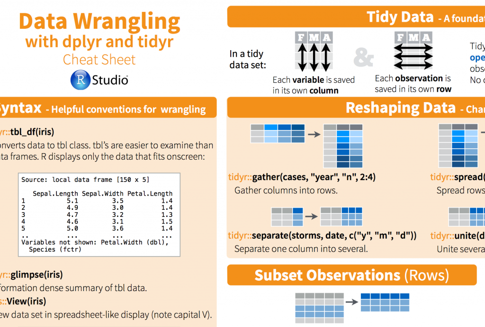

I’ve been introduced to two R packages lately and they have made my life so much easier. I am talking about dplyr and tidyr. They are great for manipulating data, meaning switching from wide to long data sets, summarize and group data. And they can easily be combined with plotting functions, such as ggplot.

The reason they are so useful is: more efficient coding, the syntax is easy to remember and easy to read. I will not explain each functions here, because there are already many good tutorials on the web. Here is a nice [cheatsheet](media/cheatsheet.pdf) for starters and some more [links](https://rpubs.com/bradleyboehmke/data_wrangling).

Thank you Richard for introducing me to tidyr and dplyr!

