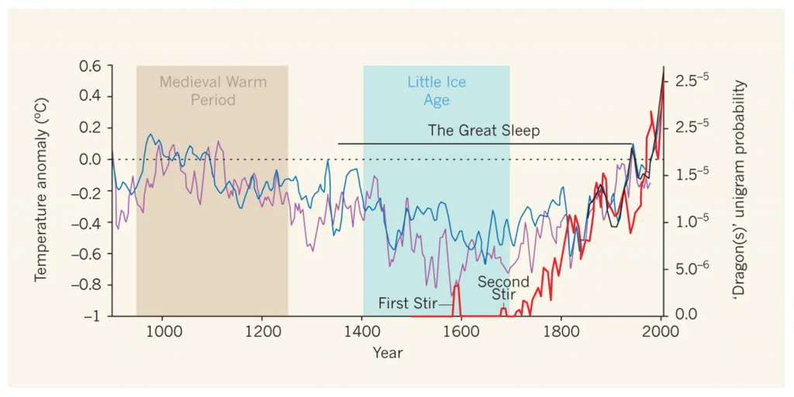

[Nature](https://www.nature.com/) has some great articles about dragons, that I came across lately. They are old, and probably well known. But I wanted to list them here anyway.

The first one by [Hamilton, May and Waters](https://www.nature.com/articles/520042a#Fig2) is a warning that with climate change, the conditions for dragon breeding are rapidly reaching ideal conditions. And they are warning that the „Third Stir“ might take place soon.

The second article I came across is on [the ecology of dragons](https://www.nature.com/articles/264016a0.pdf) by May. It is about the ecology and origin of dragons and why they might have gone extinct.

 

References

Hamilton, A., May, R. & Waters, E. Here be dragons. *Nature* **520, **42–43 (2015) doi:10.1038/520042a.

May, R. M. (1976). The ecology of dragons. *Nature*, *264*(5581), 16.
