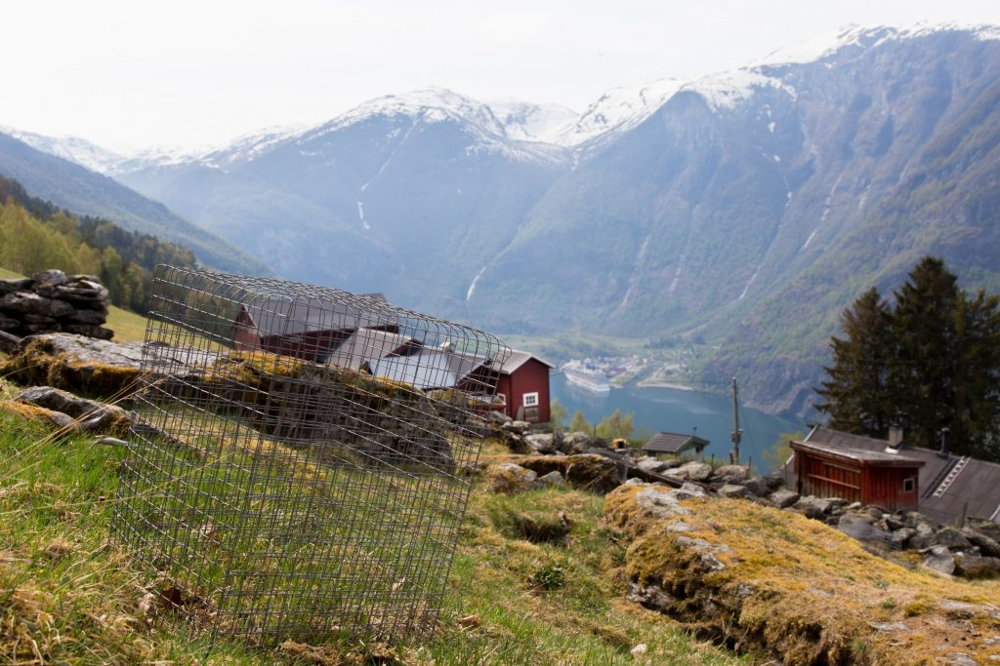

A couple of weeks ago, I went to the field for the first time in the [THREE-D project](/research/three-d/). In this project, we want to disentangle the impact of different global change drivers on biodiversity and the carbon cycle. We need to select new sites and set up the whole experiment this summer in western Norway and eastern Himalaya in China.

This first round was to set up grazing exclosures. We want to get and estimate of the grazing intensity along the elevational gradients, to know how much biomass is removed over the growing season. For this, we put up metal cages, that will exclude large herbivores and this will be compared with control plots without cages. The biomass in these plots will be harvested, dried and weighed. A master student will work on this project in Norway this summer.

<figure class="wp-block-image">

</figure>
