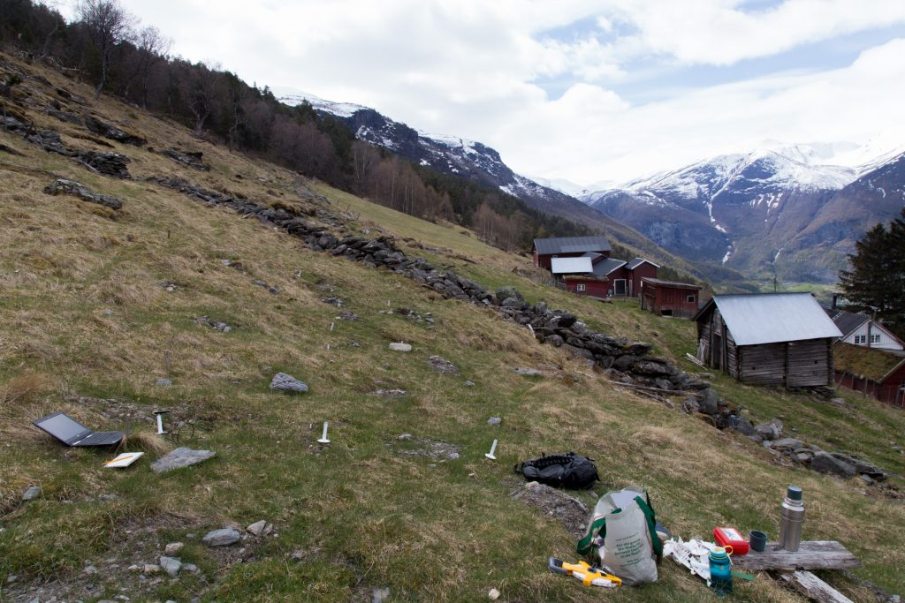
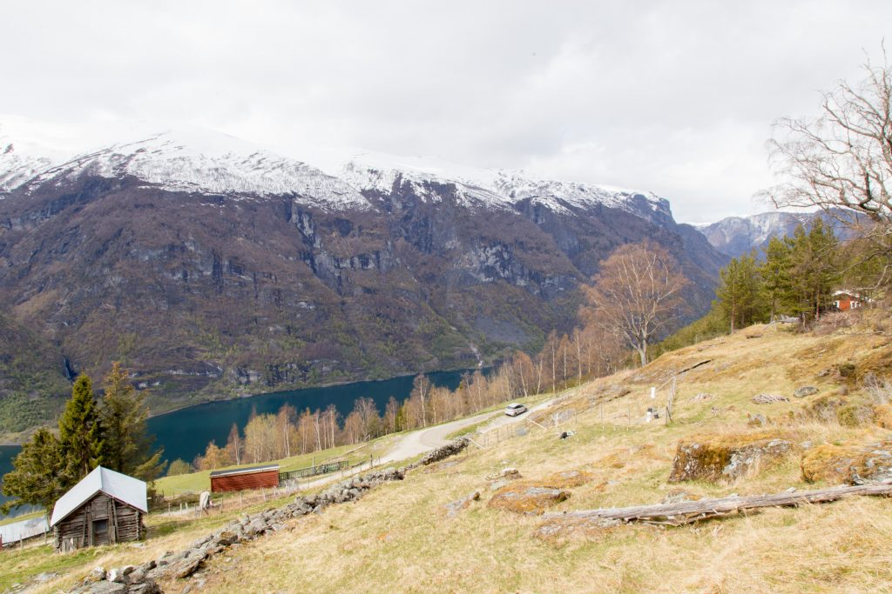
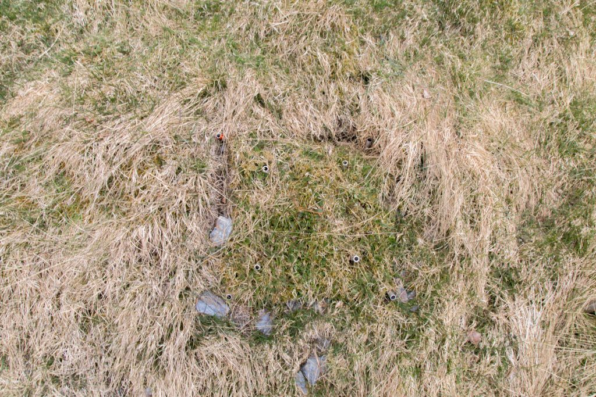

Yesterday, was the first day in the field after winter break. It was good to get out of the city, drive trough the country side and spend a couple hours outside and far away from my home office.

I stopped at Flåm and it was strange to see the place so empty. Usually this place is swamped with people and cruise ships at this time of the year. Sadly, Flåm and Aurland are the places with the highest unemployment rate in the country. Hopefully, things are getting back to normal soon.

It is very cold at the moment and summer is far away. There is a lot of snow in the mountains that still has to melt. Who know when the field season in the mountains will start.

The [turfs](/transplant-vegetation/) I transplanted last summer look happy. The Tomst loggers that measure the microclimate do not. They have all lost their „hats“ (protection from direct sunlight). Probably the snow, but maybe also deer that found something to play with.

The next step will be to get a fence around the plots, to protect them from the goats.

  
