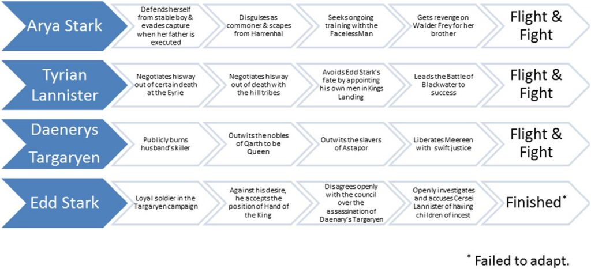

Recently, I came across an article about [mortality and survival in Game of Thrones (GoT)](https://injepijournal.biomedcentral.com/articles/10.1186/s40621-018-0174-7). The study is published in Injury Epidemiology, examining the survival of 330 main GoT characters, sociodemographic factors, time to death, and circumstances of death. They find that mortality risk is high and characters are more likely to die if they are male and lowborn.  
The article is a great read including humorous aspects. I started to search for other GoT research and found astonishingly many articles. And there is probably more!

[Fight, flight or finished: forced fitness behaviours in ](http://dx.doi.org/10.1136/bjsports-2017-098170)*[Game of Thrones](http://dx.doi.org/10.1136/bjsports-2017-098170)* by Rhodes and Zehr discusses the forced fitness behaviours and associated hormonal responses in GoT.

<figure class="wp-block-image">

<figcaption>Figure from Rhotes and Zehr 2017.</figcaption>
</figure>

The purpose of the study from [Daniel and Westerman (2017)](https://www.tandfonline.com/doi/abs/10.1080/08824096.2017.1285757) is to determine how people reacted to the end of a parasocial relationship per a character death, by analysing Twitter reactions after the death of fictional character Jon Snow from Game of Thrones. They found that we may respond to a television character’s death in some similar ways as a real person’s.  
[Jules and Lippoff (2016)](https://jamanetwork.com/journals/jamadermatology/fullarticle/2542703) investigate the dermatological deaseas called Greyscale and compare it to the Hansen disease, or leprosy.  
And finally, Clapton and Shepherd (2017) show that cultural texts such as GoT can show us different ways of thinking about the world.

There must be more articles that in a serious (or not so much) way try to gain knowledge from a television serious or how we react or interact with/to it. I would love to study some ecological aspect of Game of Thrones. Maybe something about the dragons…

**References:**

Clapton, W. and Shepherd, L. J. 2017. Lessons from Westeros: Gender and power in Game of Thrones. *Politics*. 37(1) 5–18.  
Daniel, E. S. and Westerman, D. K. 2017. [ValarMorghulis (All Parasocial Men Must Die): Having Nonfictional Responses to a Fictional Character, Communication](https://www.tandfonline.com/doi/abs/10.1080/08824096.2017.1285757). *Research Reports*, 34:2, 143-152.  
Jules B. and Lipoff, M. D. 2016. [Greyscale—A Mystery Dermatologic Disease on HBO’s ](https://jamanetwork.com/journals/jamadermatology/fullarticle/2542703)*[Game of Thrones](https://jamanetwork.com/journals/jamadermatology/fullarticle/2542703). JAMA Dermatol. *152(8):904.  
Lystad, R. P. and Brown, B. T. 2018. [Death is certain, the time is not”: mortality and survival in ](https://injepijournal.biomedcentral.com/articles/10.1186/s40621-018-0174-7)*[Game of Thrones](https://injepijournal.biomedcentral.com/articles/10.1186/s40621-018-0174-7). Injury Epidemiology*2018**5**:44  
Rhodes, R. E. and Zehr, E. P. 2017. [Fight, flight or finished: forced fitness behaviours in ](http://dx.doi.org/10.1136/bjsports-2017-098170)*[Game of Thrones](http://dx.doi.org/10.1136/bjsports-2017-098170).*
