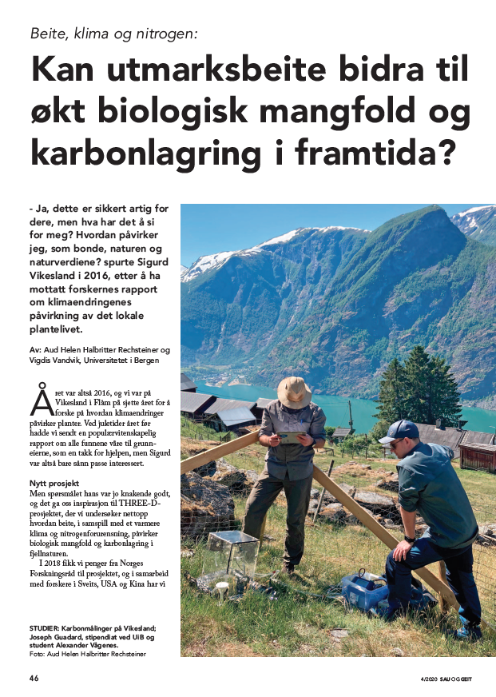

Grazing has a long tradition in the alpine areas in Norway. In the last years grazing in alpine areas has gone down dramatically with consequences for the ecosystem. Grazing is an important factor in these areas and helps to shape the open grasslands we are use to.

In addition, grazing can be beneficial for the carbon storage in alpine soils. The important factor is the intensity of grazing, which should not be too high or too low. This is what the [THREE-D project](/research/three-d/) is investigating.

I have written a popular science article in the magazine Sau og Geit about these complex interactions and how grazing can be beneficial for nature. You can read the article [here](media/sau_geit_4_2020_46_50.pdf) (in Norwegian).

