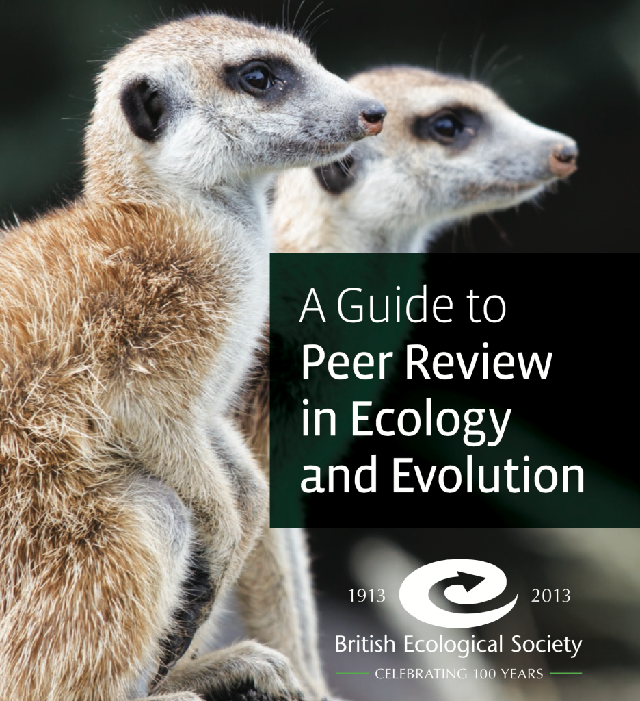

I found a useful [guide-to-peer-review](media/Guide-to-Peer-Review.pdf) for doing peer reviews by the [British Ecological Society](http://www.britishecologicalsociety.org/). It explains the whole process of peer-review, which can be useful for young researchers unfamiliar with the process. And it gives a lot of tips and questions to keep in mind when doing a review.

