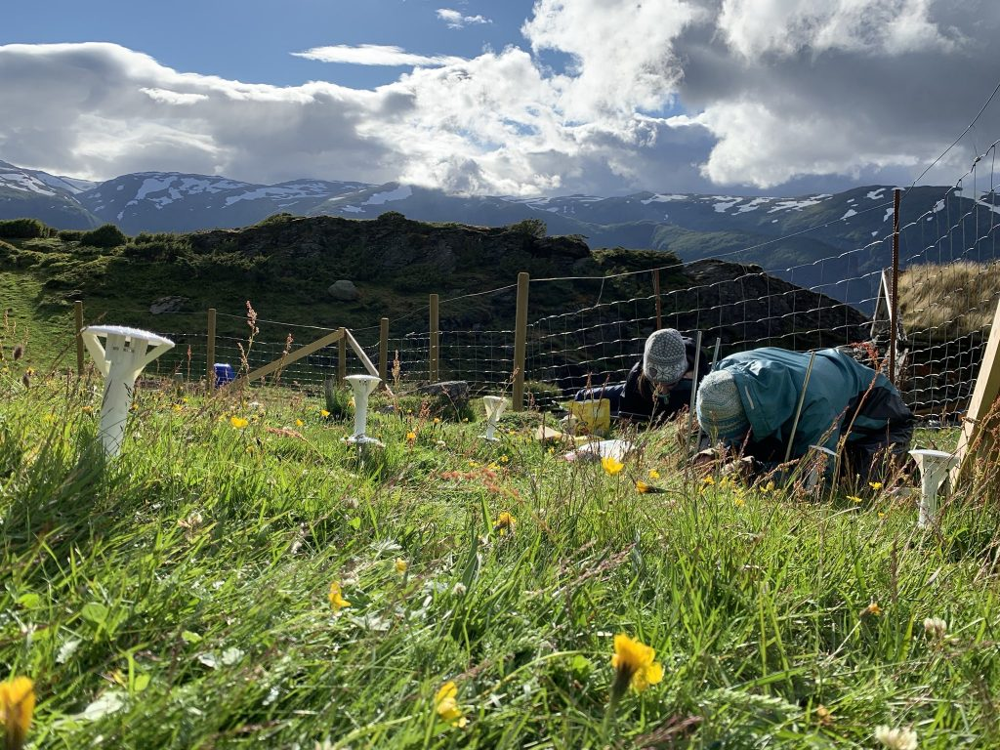
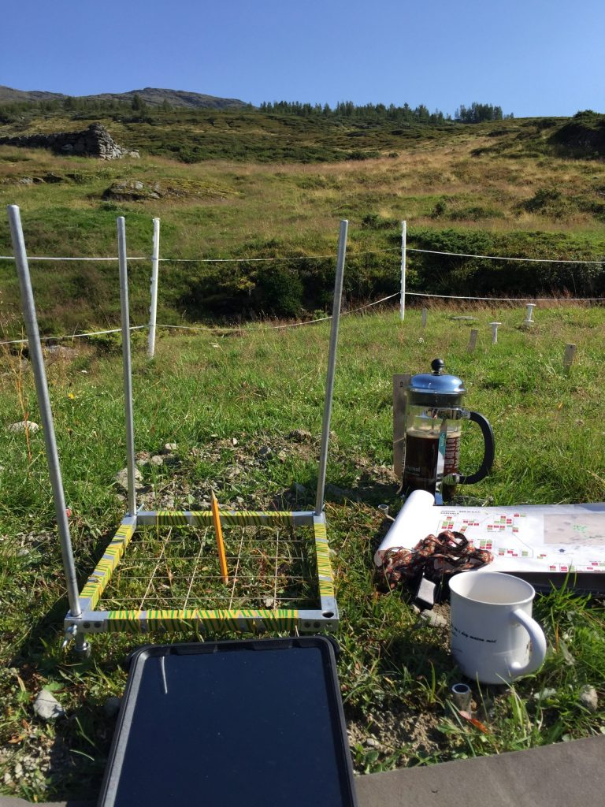
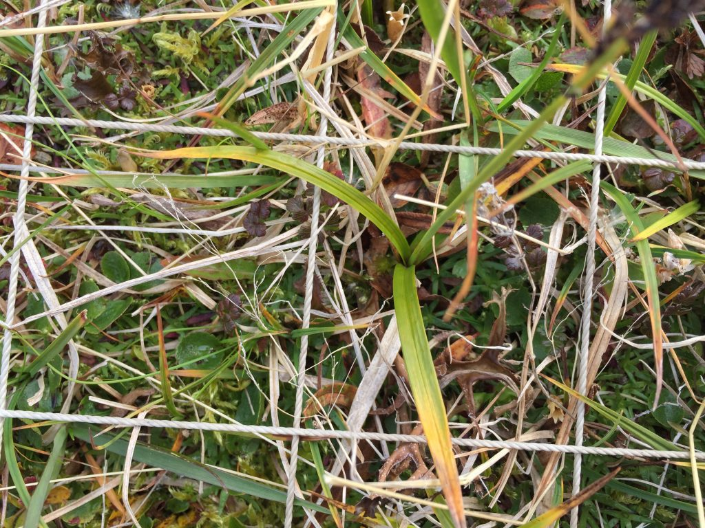

In the [Three-D project](/research/three-d/) we measure how plant species composition responds to global change. Plant species composition is a common response variable in community ecology. But how is it measured?

Recording species composition at Joasete, Norway. Photo: Vigdis Vandvik.

Basically, we lie on the grass the whole summer and stare at the vegetation. My husband once said when asked what I am doing „She pets the plants“. That’s pretty much what it looks like, but there is a bit more to it.

We are using the visual cover estimate method. Our plots are 25 x 25 cm large, and marked permanently with metal tubes in each corner to relocate the plots each year. For the measurements, we use a metal frame, the same size as the plots with a grid of 25 subplots. In every subplot, we record the presence of all graminoid and forb species. In addition, we also record if a plant is fertile (if it has buds, flowers, seeds), is a seedling, juvenile or dominant (covers \> 50% of the subplot). Once all the species are recorded in each subplot , we visually estimate the cover of each species on the whole plot. This might seem like an inaccurate method. Yes, it needs some practice to estimate the cover and some species are more difficult than others. If several people record the data, they need to standardize their estimates at the start. We usually estimate the cover for a couple of plot together in the beginning to calibrate.

Using a metal frame with 25 subplots to estimate plant cover.

How do we deal with unknown species? That’s a good question. There are always a couple of plants that cannot be identified. It can be because they are seedlings, juvenile, funny shaped, sterile, grazed or damaged. For the seedlings, which are not always easy to identify we have a column where we count the number of seedlings in each subplot. If the plants are not fully grown and difficult to identify, we note down juvenile to indicate the identity is not 100% certain. Usually, the following year, the species is fully grown and we know what it is.

Sterile or damaged graminoids are often a problem. For example, to identify Carex species it is important to have the flowers, seeds and leaf tips. But the species do not flower every year and sometimes get chewed on. When we have species that cannot be identified, we give them descriptive names, like „Dark green thin m-shaped Carex“, „Beautiful Agrostis“, „Carex norvegica cf“. And we add a description of the species. Sometimes in the next plot you come across the same species with a flower and can identify it. Other times you have to wait until the next season to solve the riddle. The important thing is to describe the plants suficiently and make sure to divide the unknown plants into different species. They can always be merged later if they turn out to be the same species. It is impossible to divide them into different species later.

A sterile Carex species.

What can be done to ensure quality control? There are several things that can be done. If several people do the recording, some of the plots should be done twice by two different people to compare the results. This is time consuming, but very useful. I always take a picture of each plot. This can help me when I am processing and cleaning the data to solve issues with the data. Recording species cover is time consuming and it is important to take the time it needs in the field to find and identify all the species. I have started to use a tablet to record the data in the field. And the data sheet is a little bit intelligent and can tell me if I am missing some data or if numbers are completely wrong. This is a great help to avoid mistakes that happen very often when recording data on paper.

For more details, see the ClimEx handbook of standardized measurements, protocol [4.8 Plant Community composition](https://climexhandbook.w.uib.no/2019/11/04/plant-community-composition/).
