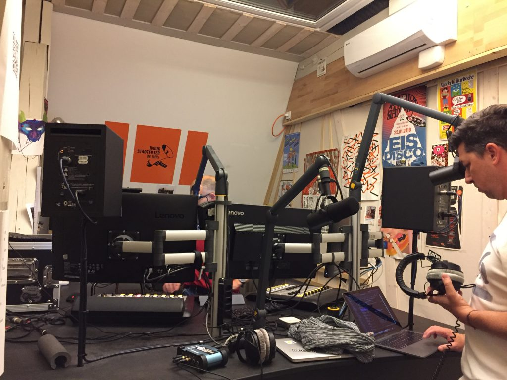

I was the on the radio [@stadtfilter](https://twitter.com/stadtfilter) yesterday talking about my work, [\#RaspberryPi](https://twitter.com/hashtag/RaspberryPi?src=hashtag_click)’s, traits and climate change. The interview is in Swiss German and you can listen to it [here](https://nerdfunk.ch/podlove/file/1070/s/download/c/select-show/191008-Nerdfunk-497.mp3).

<figure class="wp-block-image is-resized">

</figure>
