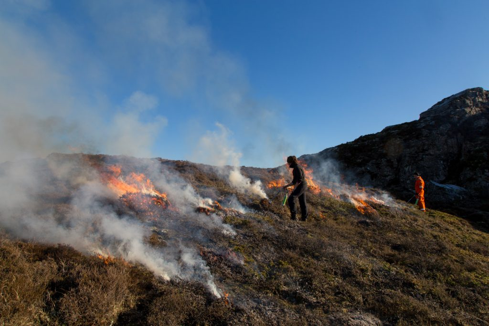
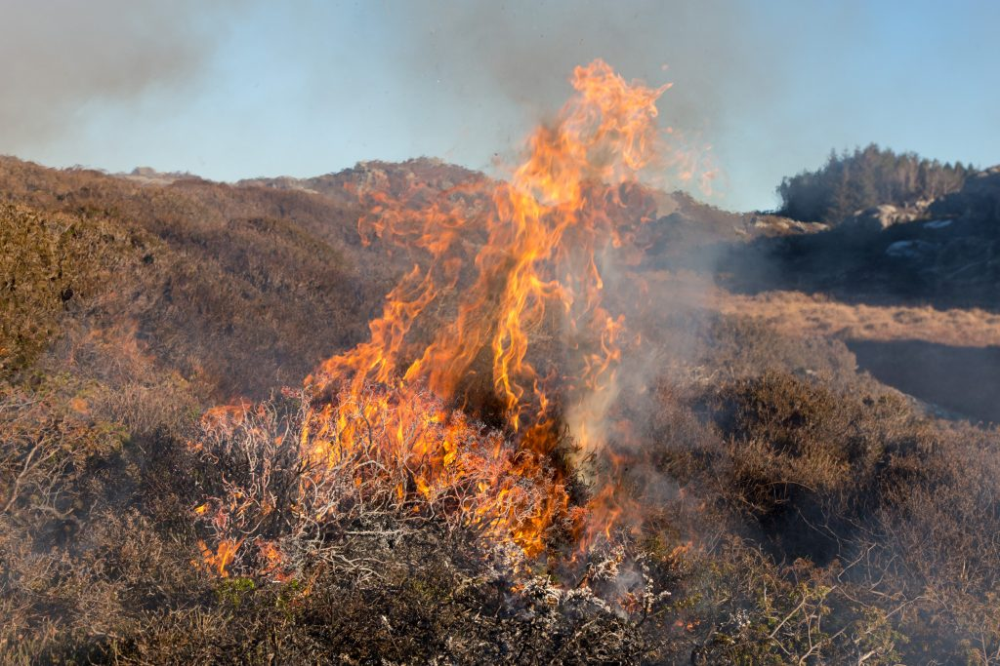
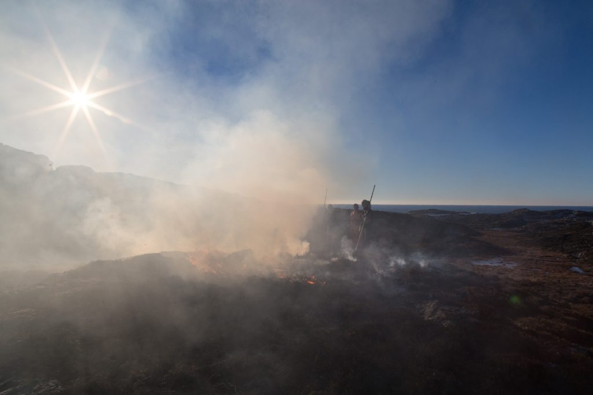

Heathland are costal habitats shaped by humans hundreds of years ago. They were burned to clear the land for their animals. Burning the heathland was continued to improves the fodder quality and prevent shrubs and trees to grow in the heathland.

In 2014 an intensive drought led to heather death along the coast of Norway. [Landpress](http://www.uib.no/en/rg/EECRG/95156/landpress) tests whether heather burning is an effective measure to prevent drought damage and restore damaged moorland.

Last week, one of the sites, close to Bergen was burned.

  
