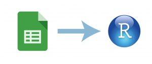

[](media/GoogleSheetR.jpg)

It is getting more and more common to share data or work colaboratively when collecting and/or analysing data. A useful tool when working with collegues are online solutions. And without saying that this is the best or the only one, I often use google sheet, because many people have access and it is easy to use.

On a course a couple of weeks ago, where we collected a lot of data, I had several students type data into the same goole sheet. The question was then, do I download the table and then import it to R or is is there a direct way. And of course it is possible to import a google sheet directly to R. I discoverd the googlesheets package! It is very easy to use.

You need to have google account. The first time, you need to login to your google account and accept the connection with R. In some cases you will get a code that you have to type a code into the console in R (not sure when and why).

And here some useful functions:

- The “gs_ls()” function will give you an overview over all the tables you have access to. It is sometimes required that you have the table stored in your own folders (in google drive you can move tables to your own folers).
- With “gs_title()” the metadata of the sheet is registered. The table is not loaded yet!
- “gs_ws_ls()” gives you a list of all the worksheets in the sheet you want to load.
- And finally, “gs_read()” reads the sheet and returns it as data frame. Here you define which sheet you want to load (ss = ) and which workshee (ws = ).

``` r
#### IMPORT DATA FROM GOOGLESHEET ####

# install (only the first time) and load library
install.packages("googlesheets")
library("googlesheets")

# Check which tables you have access to
gs_ls()

# Register a google sheet (metadata about the sheet)
Sheet <- gs_title("NameOfGooglesheet")

# list worksheets
gs_ws_ls(Sheet)

# reads the googlsheets and returns as data frame
dat <- gs_read(ss = Sheet, ws = "NameOfSheet") %>% as.tibble()
```
