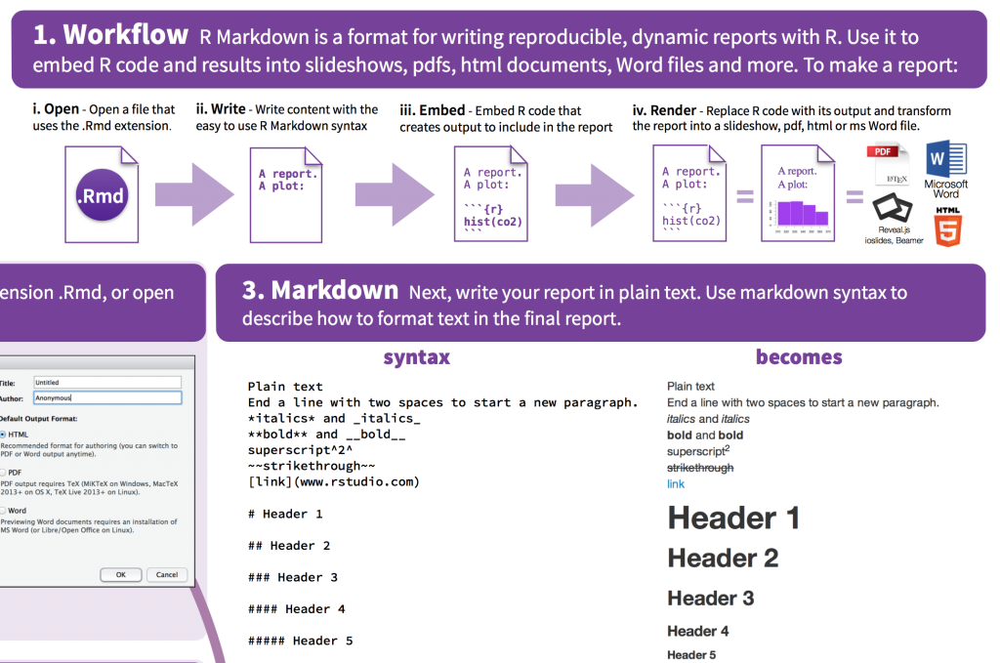

I am creating my first markdown for the next blog entry. It’s very useful, because you can combine texte and R script using R. And while I was googling how to start I found this very useful [cheatsheet](media/cheatsheet.pdf) by [R markdown R Studio](http://rmarkdown.rstudio.com/).

