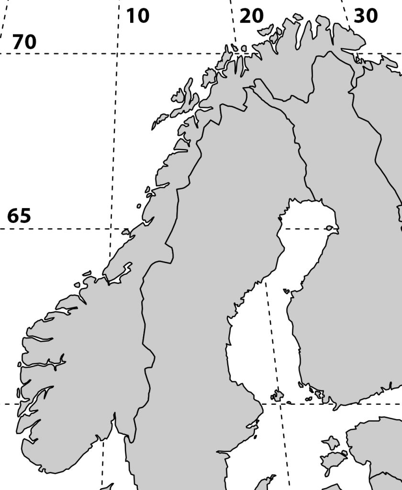
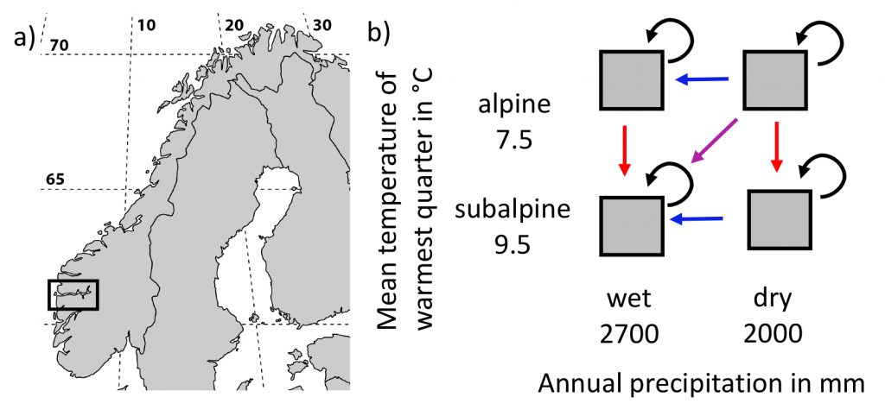

I’m working on a manuscript on phenology in the [SeedClim](/seedclim-large-scale-climate-change-experiment-in-the-western-norwegian-fjords/) grid and it is always nice to show the study site in a map. But where to get a decent map. It is possible to download blank maps from the internet, but this requires citing the source. So, I decided to make my own map. After googling a bit I found a nice code for a map of Scandinavia including a grid for the coordinates. Selecting the area and adding the numbers was done in Photoshop.

For R code see below.

library(„maps“)  
library(„mapproj“)  
par(mar = rep(0.1,4))

\#force map to cover Norway, Finland and Latvia  
map(region = c(„Norway“, „Finland“, „Latvia“), proj = „sinusoidal“, type = „n“)

\# draw coordinates  
map.grid(c(0,40, 55, 80), nx = 5, ny = 5, col = „black“)  
map(xlim = c(-130, 130), col = „grey80“, fill = TRUE, proj = „“, add = TRUE)

Code adapted from <a href="https://quantpalaeo.wordpress.com/2016/02/12/more-maps-in-r/amp/" rel="home" title="Musings on Quantitative Palaeoecology">Musings on Quantitative Palaeoecology</a>
