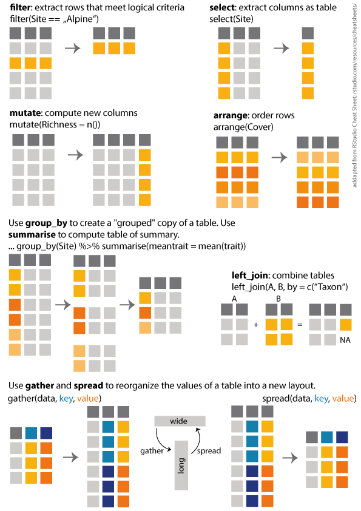

I made a overview of the dplyr functions i use most often. The overview is heavily adapted from [RStudio Cheat Sheets](https://rstudio.com/resources/cheatsheets/), and I made it for the students in my Ecology class. Yes, we do use R in a basic ecology class. Here you can download a [pdf](media/Dplyr.pdf).

<figure class="wp-block-image">

</figure>
