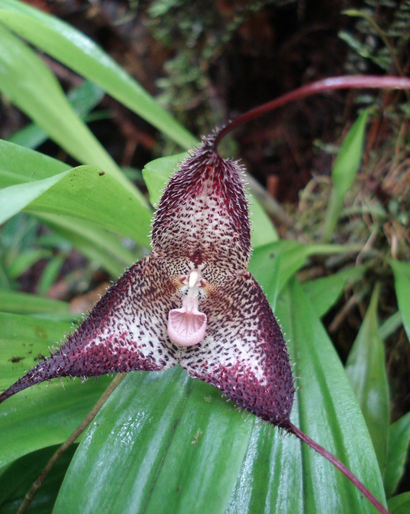

Tobias Policha and collegues published an interestig article how they used 3D printed flowers to disentangle visual and olfactory signals in an orichid. You can get to the [article here](http://onlinelibrary.wiley.com/doi/10.1111/nph.13855/abstract). The picture shows a *Dracula lafleurii*.

Flowers use olfactory and visual signals to communicate with pollinators. Disentangling the relative contributions and potential synergies between signals remains a challenge. Under- standing the perceptual biases exploited by floral mimicry illuminates the evolution of these signals. Here, we disentangle the olfactory and visual components of Dracula lafleurii, which mimics mushrooms in size, shape, color and scent, and is pollinated by mushroom-associated flies.

To decouple signals, we used three-dimensional printing to produce realistic artificial flower molds that were color matched and cast using scent-free surgical silicone, to which we could add scent. We used GC-MS to measure scents in co-occurring mushrooms, and related orchids, and used these scents in field experiments.

By combining silicone flower parts with real floral organs, we created chimeras that identi- fied the mushroom-like labellum as a source of volatile attraction. In addition, we showed remarkable overlap in the volatile chemistry between D. lafleurii and co-occurring mush- rooms.

The characters defining the genus Dracula – a mushroom-like, ‘gilled’ labellum and a showy, patterned calyx – enhance pollinator attraction by exploiting the visual and chemosen- sory perceptual biases of drosophilid flies. Our techniques for the manipulation of complex traits in a nonmodel system not conducive to gene silencing or selective breeding are useful for other systems.

Picture from: http://cascade.uoregon.edu/fall2010/natural-sciences/natures-masters-of-disguise/
