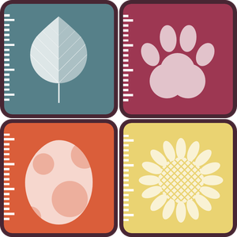

The popularity of using traits data in ecology has increased a lot in the last years. Traits can be used to describe species communities across different regions and how they respond to environmental change, and much more.

The goal of [OpenTraits](http://opentraits.org/) is to increase our global knowledge of traits from different organisms by

- Developing shared data standards;
- Developing open-source tools and techniques for gathering, cleaning, curating, and analyzing trait data;
- Developing methods for the prioritization of trait sampling;
- Increasing collaboration among trait researchers; and
- Organizing trait sampling efforts for priority regions, taxa and traits.

If you are interested to learn more about OpenTraits, there is a [blog post](https://functionalecologists.com/2018/06/01/announcing-the-first-opentraits-workshop-4-5-august-2018-new-orleans/#more-1678) on the Functional Ecologist blog and there will be a workshop prior to the Ecological Society of America annual meetings, New Orleans, Louisiana, USA (August 4-5, 2018).

