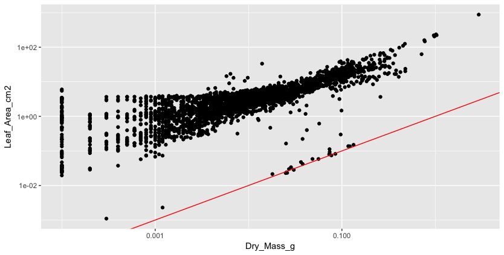
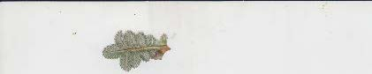

**Learning – how to measure plant functional traits – the hard way (a story in 4, or more, parts)**

This is the story of how we organized our [*TraitTrain*](https://www.uib.no/en/rg/EECRG/78461/transplant-traittrain) courses and what we learnt from our mistakes. With TraitTrain we want to strengthen research and educational collaborations over climate change and ecosystem ecology by organizing courses for students on how to measure plant functional traits and at the same time offer the students a relevant research experience. In the [first part](/part-1-the-invention-of-the-trait-wheel/) I explained how we organized the collection of the leaf traits, the so called *trait wheel*. Here, I want to talk about the 3rd step in the trait wheel: scanning the leaves.

Leaf area is a common measure of leaf size and is usually very plastic to climatic variation and/or stress. Leaf area is also important because it is used to calculate SLA (specific leaf area). To calculate leaf area, a leaf is scanned [(for details see Pérez-Harguindeguy et al. 2013)](https://paperpile.com/c/nbb5Ae/iwUO/?prefix=for%20details%20see) and the scan is then run through a program such as ImageJ, which calculates the area of the leaf. We use ImageJ via the r package LeafArea.

All of this should be easy, except it wasn’t.

On the course each student had a laptop, which we then connected to the scanners. We usually have 4-5 scanners, because this is a time demanding job. On the TraitTrain courses, we have students from all over the world and they come with all sorts of laptops (brands, operating systems and settings). The instructions said to scan the leaves with specific settings (e.g. 300 dpi). For some reason, the scans from people with different settings on their computers (A4, letter,…) resulted in different leaf areas. We are still not sure how this happened, because when you set the resolution, the size of a scan should not make a difference.

The second problem was that many pictures had black edges around them (see picture 1), which was added to the leaf area. We did not understand this until we plotted leaf area against dry mass, which should be a more or less linear relationship. Instead the plot looked like a *chicken foot* (this expression might also have been inspired by all the chicken feet that were swimming around in our hotpots). It tooks us a while to figure this out and we had to look at each individual scan to make identify several of these problems.

<figure class="wp-block-image">

</figure>

<figure class="wp-block-image is-resized">

<figcaption>Top: Dry mass (g) plotted agains leaf area (cm2). Bottom: Leaf scan, where the edge has a black line.</figcaption>
</figure>

How did we solve these issues for the next courses. First of all we wanted to make the scanning a standardized process and not dependent on the settings of peoples laptops. We bought a couple of raspberry pi’s, which operated the scanners. We used the laptops as screens and keyboards to operate the scanner and pi’s.

Second, we implemented a couple of checks. The pi automatically checked if the scanning settings were correct (resolution, size, colour depth, file type), if the person scanning the leaf had typed in the correct LeafID and if the scan was saved in the right place. If you are interested in how we set up the pi and scanner, all the scripts we used is available on [github](https://github.com/EnquistLab/PFTC4_Svalbard).

We also realized that for checking the quality of the data and finding errors, we need a size reference on each scan. For this we added a ruler to each scanner (ruler glued to each scanner; see picture 2), which allowed us to directly check if the leaf area was calculated approximately right. This turned out to be very useful. One problem that occurs is of course you do not want to have the ruler on the scan when you calculate leaf area. The LeafArea package allows to cut a certain amounts of pixels on each side of the scan. This is very useful and also solves the problem with the black lines. The problem was now that we could only cut the same number of pixels on each side. But what we wanted was to cut more on the side where the ruler was added and less on all the other sides of the scan. For this we customize the run.ij function in the LeafArea package. If you want to use our customized run.ij function, run this code first in r devtools::install_github(„richardjtelford/LeafArea“). Then the run.ij function has an argument “trim.pixel2”, which allows to cut more pixels on the right side of the scan.

<figure class="wp-block-image">

<figcaption>Leaf scan including a ruler as reference on the top.</figcaption>
</figure>

Visual inspection of each scan turned out to be essential even by optimizing the scanning process. It is important to check the right number of pixels are cropped before calculating the leaf area, you can check that the full leaf is scanned and you can detect folded leaves. By checking each individual scan, we also found that some of the scans were really dirty. This happens, when working with plant material that comes from the field. And now, we tell the students to check and clean the scanner often. And finally, grasses can be difficult, because they tend not to lie flat on the scanner. They curl. Here, the answer was to use transparent tape to glue the leaves onto the scanner.
