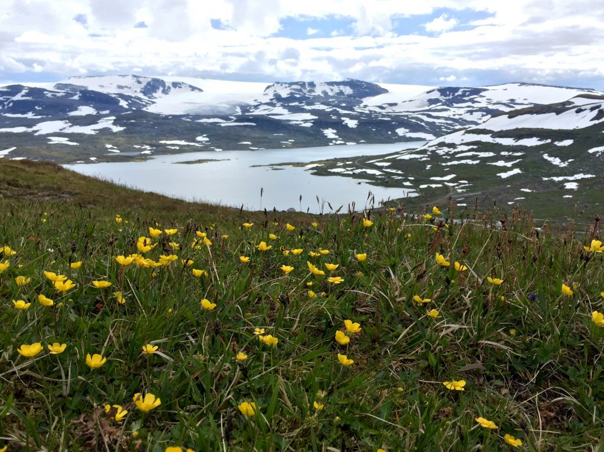
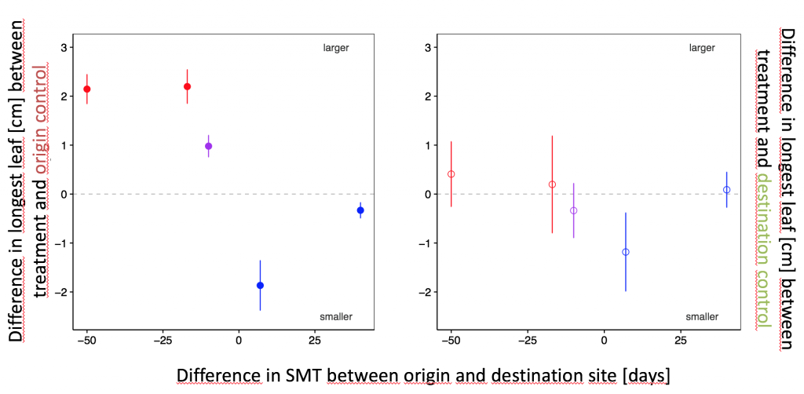
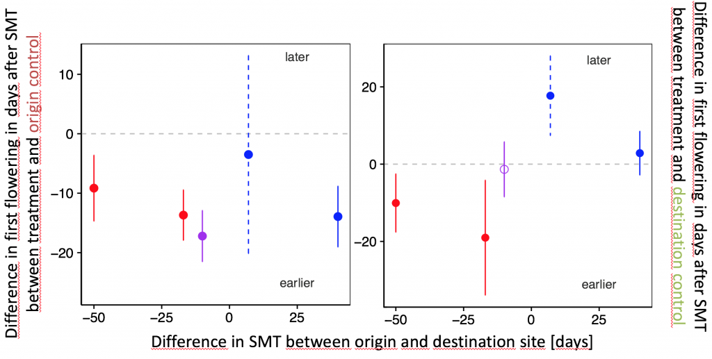

Our new article on plastic and genetic responses to shifts in snowmelt time in *Ranunculus acris* has just been accepted in PPEES. I will present the study at the [ESA in Portland in August](https://eco.confex.com/eco/2017/webprogram/Paper65789.html).

Changes in both temperature and precipitation will affect snowmelt time at high elevation, thereby influencing plant reproduction and growth. Species can respond to changed climate with phenotypic plasticity or genetic adaptation, and these responses might vary at different levels of advanced and delayed snowmelt time. Here we mimicked future climate change projections for western Norway by transplanting individuals of *Ranunculus acris* towards warmer, wetter and warmer & wetter climates. And we replicated the experiment along regional-scale temperature and precipitation gradients. This setup resulted in both advanced (warmer and warmer & wetter transplants) and delayed (wetter transplants) snowmelt in the experimental sites. We recorded phenological development and growth over one growing season.

The reproductive phenology of the transplanted *R. acris* individuals was affected by both phenotypic plasticity and genetic differences between populations of different origins, while growth showed only plastic responses. Plants expressed high plasticity to both advanced and delayed snowmelt time by acceleration of the onset of buds, flowers and fruits. Only the plants from wet and high-elevation sites showed a small response to advanced SMT. The late snowmelt time these populations experience could potentially cause high selection pressure leading to more constrains in plasticity. When grown under common conditions, plants from late snowmelt sites responded with earlier onset of phenological development, suggesting that the timing of snowmelt exerts strong selection on reproduction. To project species fates under future climate we need to consider the interplay between genetic adaptation and plastic responses under different climate contexts, especially towards the species range limits.

 

Plasticity and genetic difference in growth (top) as the difference in leaf size +/- 2SE in cm (top) and first flowering in days after snowmelt timing (SMT; bottom) between treatment and origin-control (left) or destination-control (right) plants. The x-axis represents the difference in SMT between origin and destination site. The colours indicate the transplant treatments to: warmer (red), wetter (blue) and warmer & wetter (purple) climate. Points above/below the dashed grey line indicate larger/smaller leaf size or earlier/later days since SMT for first flowering in the transplanted plants compared to the origin-control (left) or destination-control (right) plants. Closed circles indicate a significant difference between treatment and destination-control plants and open circles no significant difference. Dashed error bars indicate a sample size lower than 6 individuals.

Delnevo, N., Petraglia, A., Carbognani, M., Vandvik, V. and Halbritter, A.H. (accepted). Plastic and genetic responses to shifts in snowmelt time affects the reproductive phenology and growth of *Ranunculus acris*. PPEES.
