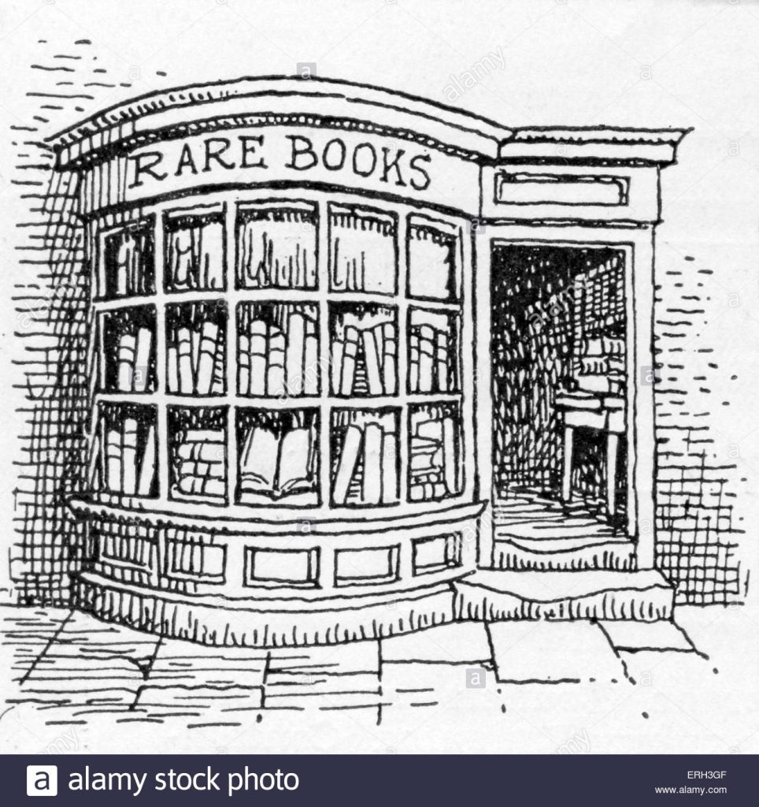

<figure class="wp-block-image is-resized">

</figure>

A lot of phenology papers this week, because I am working on an article. And only 5 papers, because I also reviewed one paper.

Vermeulen. 2015. [On selection for flowering time plasticity in response to density](https://nph.onlinelibrary.wiley.com/doi/full/10.1111/nph.12984). *New Phytologist*, 205: 429–439

I only managed to read this paper… but I read a lot of other paper, for writing the introduction to a paper. Just not the once I had thought. So here a few papers I actually read.

Wipf. 2010. [Phenology, growth, and fecundity of eight subarctic tundra species in response to snowmelt manipulations](https://link.springer.com/article/10.1007/s11258-009-9653-9). *Plant Ecology,* 207: 53–66.  
Kawai, Y., Kudo, G., (2011). [Local differentiation of flowering phenology in an alpine- snowbed herb Gentiana nipponica](http://www.nrcresearchpress.com/doi/abs/10.1139/b11-024). Botany 89: 361–367.  
Cooper, E. J. et al. 2011. [Late snowmelt delays plant development and results in lower reproductive success in the High Arctic](https://www.sciencedirect.com/science/article/pii/S016894521000261X). – Plant Sci. 180: 157–167.  
Totland, Ø. 1993. [Pollination in alpine Norway: flowering phenology, insect visitors, and visitation rates in two plant communities](http://www.nrcresearchpress.com/doi/abs/10.1139/b93-124#.XE35Hc9KjMU). – Can. J. Bot. 71: 1072–1079.  
Totland, Ø. 1994. [Intraseasonal variation in pollination intensity and seed set in an alpine population of Ranunculus acris in southwestern Norway](https://onlinelibrary.wiley.com/doi/abs/10.1111/j.1600-0587.1994.tb00089.x). – Ecography 17: 159–165.
