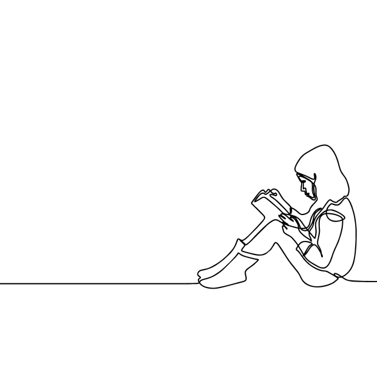

<figure class="wp-block-image is-resized">

<figcaption>Grafiken von <a href="https://de.pngtree.com/freepng/reading-book-girl--young-smart-child-one-continuous-line-art-style_3626829.html%20">pngtree.com</a></figcaption>
</figure>

Cooper. 2014. [Warmer Shorter Winters Disrupt Arctic Terrestrial Ecosystems](https://www.annualreviews.org/doi/full/10.1146/annurev-ecolsys-120213-091620). *Annu. Rev. Ecol. Evol. Syst*. 45:271–95  
Rumpf et al. 2014. [Idiosyncratic Responses of High Arctic Plants to Changing Snow Regimes](https://journals.plos.org/plosone/article?id=10.1371/journal.pone.0086281). *Plos One*. *9*(2), e86281  
Wilkinson et al. 2016. [The FAIR Guiding Principles for scientific data management and stewardship](https://www.nature.com/articles/sdata201618). *Scientific data* 3.  
Grinberg et al. 2016. [Fake news on Twitter during the 2016 U.S. presidential election](http://science.sciencemag.org/content/363/6425/374.abstract?casa_token=DM8covoxuCYAAAAA:Ebizi8K_cfN2YbFVxnczZphX-4ZlmiP5hDQ6Y05Wn78WOICLmCZSlGJhiusKLxTZpC0yXsNYg59odTk). *Science*. 363, 374–378.
