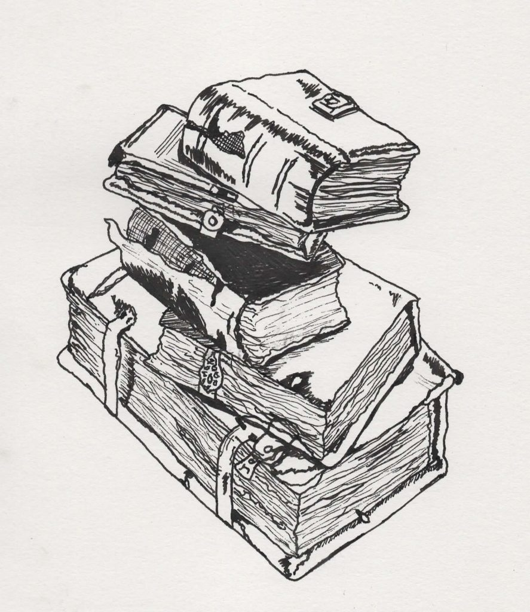

<figure class="wp-block-image is-resized">

<figcaption>EPSON MFP image</figcaption>
</figure>

This week only 4 papers, because I am doing a review and have an all day seminar on Tuesday.

Vermeulen. 2015. [On selection for flowering time plasticity in response to density](https://nph.onlinelibrary.wiley.com/doi/full/10.1111/nph.12984). *New Phytologist*. 205: 429–439  
Pyenson. 2019. [Where to find fantastic beasts at sea](http://science.sciencemag.org/content/363/6425/338). *Science*. 363: 338-339  
Popkin. 2019. [How much can forests fight climate change?](https://www.nature.com/articles/d41586-019-00122-z) *Nature*. 565: 280-282  
Dunne et al. 2004. [INTEGRATING EXPERIMENTAL AND GRADIENT METHODS IN ECOLOGICAL CLIMATE CHANGE RESEARCH](https://esajournals.onlinelibrary.wiley.com/doi/epdf/10.1890/03-8003). *Ecology*. 85: 904–916
