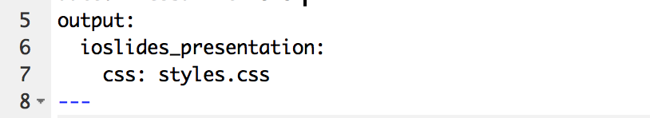
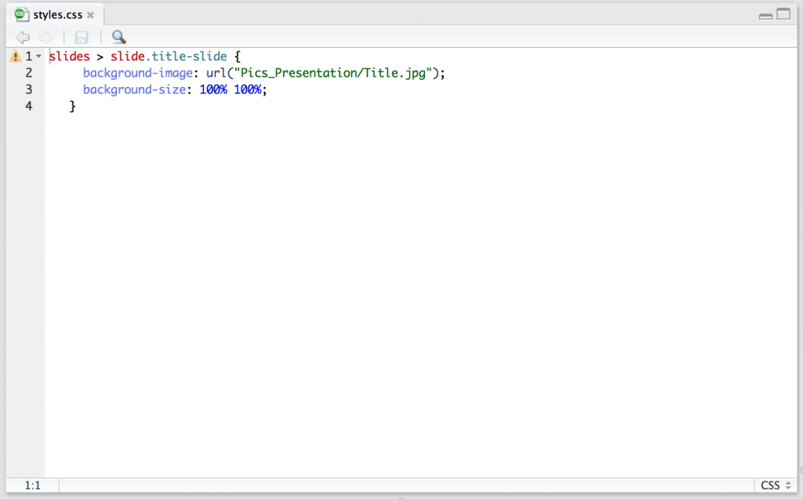

Creating presentations with RMarkdown in R is a useful alternative to using Power Point. It is very useful for code loaded presentations. But many people produce the results (figures) they present in R. And whenever something is changed in the data or code each figure has to be remade, save again and exchanged in the presentation. RMarkdown will do all that automatically.

But let’s start at the first page. Most presentations (that I have seen) have a picture on the title page, because pictures say more than words. So how do you put a picture on your RMarkdown presentation?

It took me a while to figure out, but it’s quiet easy. I assume you know how to get started with your presentation. Otherwise check out this [link](http://rmarkdown.rstudio.com/ioslides_presentation_format.html).

The first thing you need to fix are the first couple of lines in your RMarkdown file. After output you write: ioslides_presentation: css: styles.css

Make sure the spacing is right! This will tell your RMardown to look for a css file.

The next step is to create a css file. Where you then can define all sorts of things, for example to put a picture on your title page.

- open a new R Script
- type the following code in it, including the url and name of the picture you want in the presentation.

- save it as style.css (make sure that it has .css as ending and nothing else)
