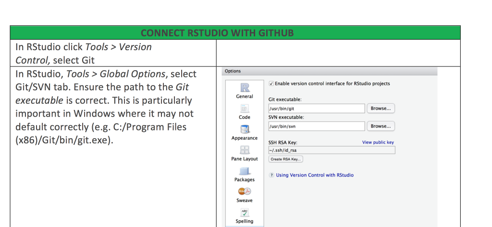

We have recently started to work with Github in our research group and I would never go back. It is a great way to collaborate on code, keep track of changes while coding and also supervising your students coding during their thesis.

Getting RStudio and Github talking can be a bit tricky. And I have put together a some instructions how to make the connection. There are different options, wether you already are on Github and want to connect your repository to a new RStudio project or the other way round, pushing an existing RStudio project on Github.

Here is the [Github – R studio Cheat Sheet](media/github-rstudio-cheat-sheet.pdf).

