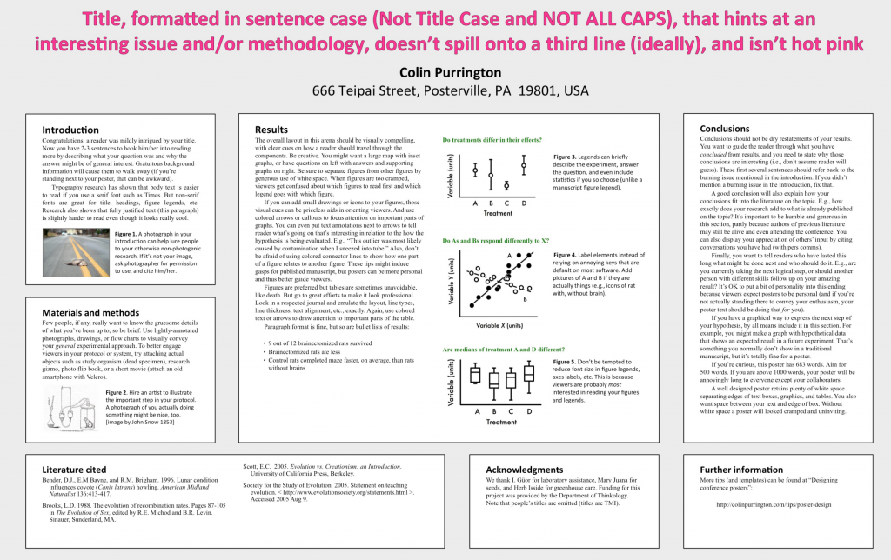

Young scientists might present their master thesis or the idea of you PhD with a poster instead of a presentation. At my first conference, I presented a poster and was relieved not having to speak to hundreds of people.

But making a good poster (that people actually read) is difficult and takes time. Don’t do it last-minute!

[Here](http://colinpurrington.com/tips/poster-design) I found a useful guide to make a poster by Colin Purrington.

 

