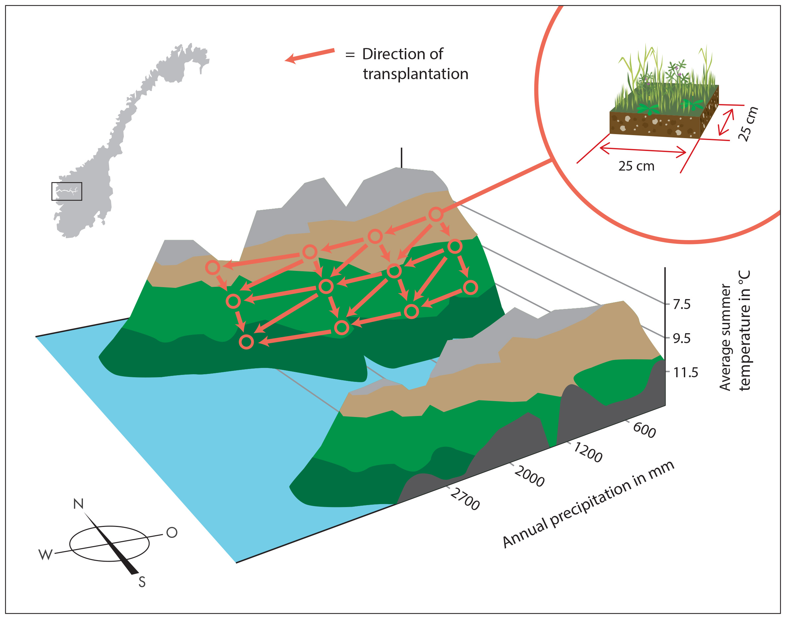
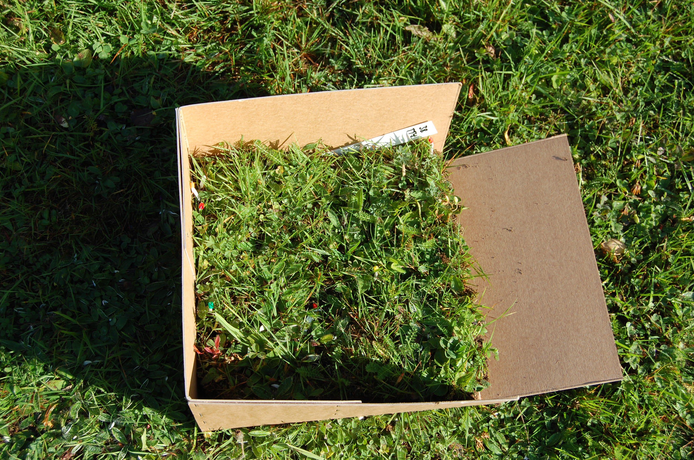
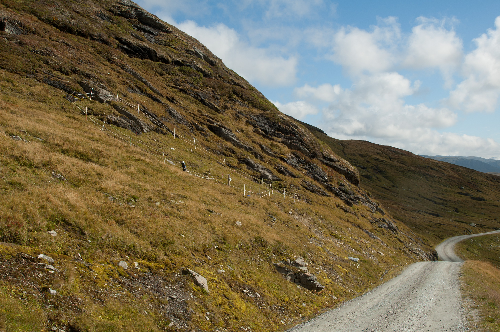

In many regions climate is predicted to become warmer and wetter, which will affect among others species composition, population dynamics and species interactions. [SeedClim](http://www.uib.no/en/rg/EECRG/55395/seedclim) is a large scale experiment in the western Norwegian fjord landscape, designed to assess independent and joint effects of temperature and precipitation on grassland communities.

In 2009, 12 experimental grassland sites were established, in a climate grid where three levels of mean summer temperature (7.5, 9.5 and 11.5°C) were combined with four levels of mean annual precipitation (600, 1200, 200, 2700mm) levels. All other conditions, like bedrock type, slope and southward exposure were kept as constant as possible.

To simulate climate change, vegetation turfs (25 x 25 cm) were transplanted to warmer, wetter and warmer&wetter conditions. A whole summer was used to find the 12 sites, which was only the start of the logistic nightmare. Each plant on the turf was recorded, and then transported to the new location. Then the turfs were left on their own for more than a year to let the vegetation recover from the transplant. In summer 2011 the turfs were re-analysed.

Studying species composition was not the only purpose of SeedClim. Since 2009 numerous experiments and observational studies have been carried out including germination study, demography, removal experiments, biomass collection and studying the bryophyte community. In the last two years a couple of new projects have started:

- [FunCaB](http://www.uib.no/en/rg/EECRG/85396/funcab) a study on the role of functional group interactions in mediating climate change impacts on the carbon dynamics and biodiversity of alpine ecosystems
- studying the effect of climate change on [phenology](/research/)
- [Drive](http://www.mn.uio.no/ibv/english/research/sections/evogene/groups/mycology/research-projects(1)/drive/): the plant root microbiome diversitz and resilience in a changing climate

 

Fig.1: Transplant design in SeedClim.

 

Fig. 2: One vegetation turf ready to be transplanted to a warmer or wetter site.

 

Fig. 3: Skjellingahaugen, the coldest and wettest sites in the grid.
