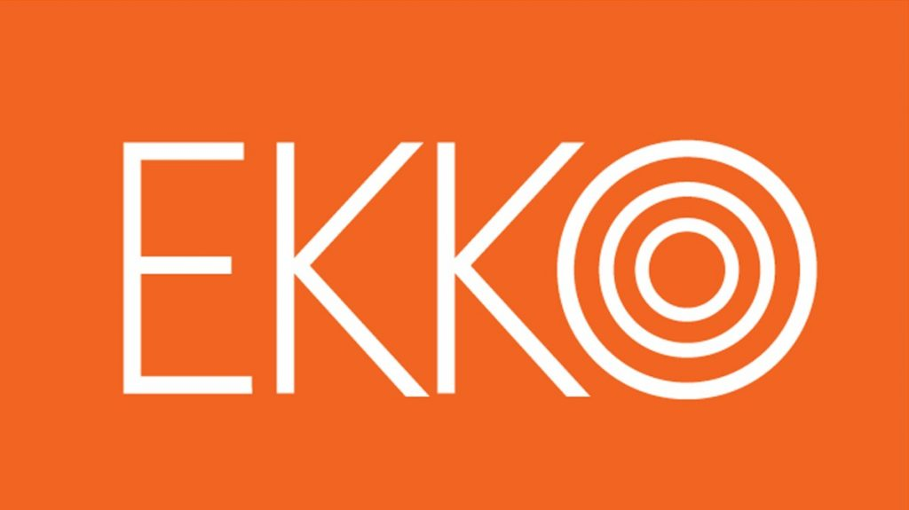

Today, Professor Vigdis Vandvik talked about the [SeedClim](http://www.uib.no/en/rg/EECRG/55395/seedclim) project on the Norwegian radio NRK in the science program [EKKO](https://radio.nrk.no/serie/ekko-hovedsending). 15 minutes on how lowland and alpine plants in western Norway will cope with future climate change.

You can listen to the show:

[Listen to the EKKO programme (mp3)](media/seedclim-ekko.mp3)

 

