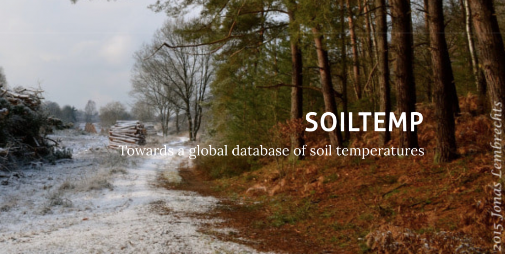

SoilTemp is a new project initiated by Jonas Lambrechts and collegues to create a global soil temperature database. The goal is to make soil temperature data available to scientist, increase and facilitate collaborations across projects and synthesise microclimate data on a global scale to answer key ecological questions.

SoilTemp has recently launched a [webpage](https://soiltemp.weebly.com/), where information regarding the data, project updates and future publications can be found. So far they have collected For 1867 temperature sensors from 11 countries, from sea level till 6194 meter above the ocean, and covering more than a decade. And the collection is ongoing.

[SeedClim](https://www.uib.no/en/rg/EECRG/55395/seedclim) has already provided their long-term (10 years) of soil temperature data. [TransPlant](https://www.uib.no/en/rg/EECRG/78461/transplant-traittrain), our Chinese Collaborators will follow.

Photo: Jonas Lambrechts
