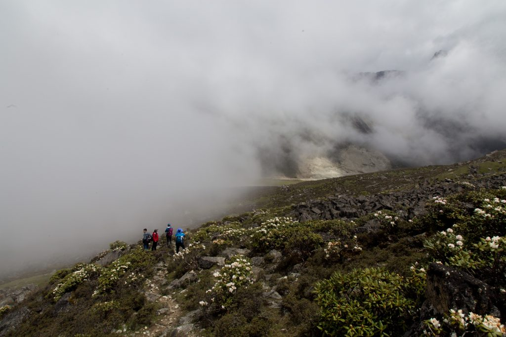
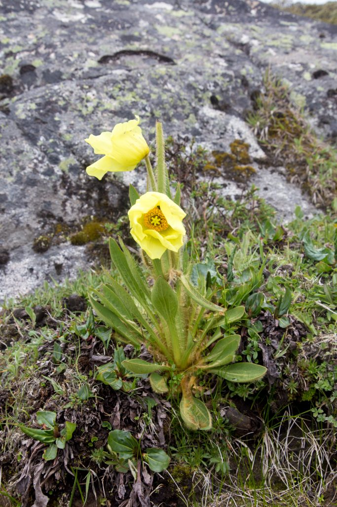
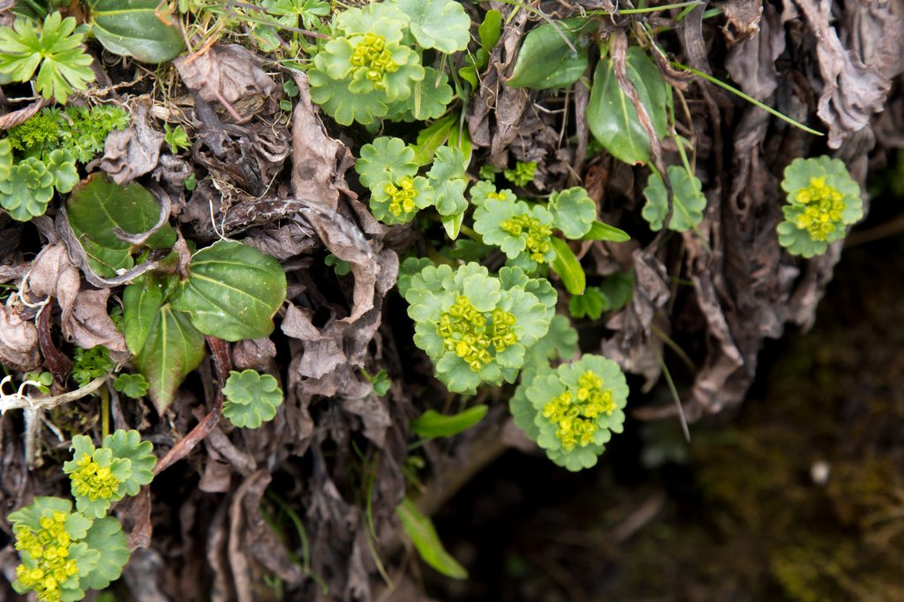
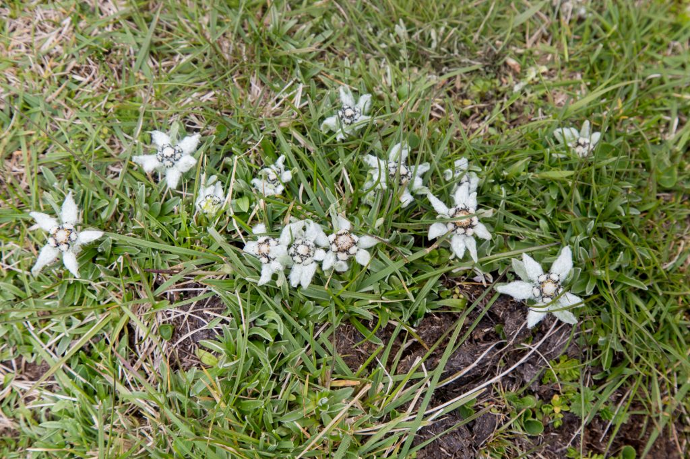

Last week I was in Mount Gongga setting up a new experiment. All the spring flowering was still in bloom. Here are just a few of them…

<figure class="wp-block-image">

</figure>

<figure class="wp-block-image">

</figure>

<figure class="wp-block-image">

</figure>

<figure class="wp-block-image">

</figure>
