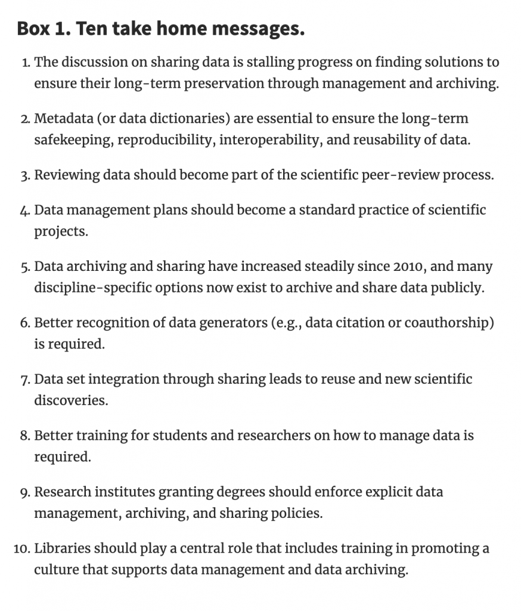

From Renaut et al. 2018. [Management, Archiving, and Sharing for Biologists and the Role of Research Institutions in the Technology-Oriented](https://academic.oup.com/bioscience/article/68/6/400/4983937) Age. *Bio Science* 68 (6) 400–411.

<figure class="wp-block-image">

</figure>
