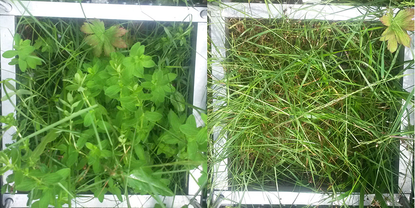

I’ve been cutting grasses and picking bryophytes for a whole day. Why the hell would anyone do that?

We have started a new project called [FunCaB](http://www.uib.no/en/rg/EECRG/85396/funcab) which tries to disentangle the roles of different plant functional groups, such as grasses, herbs and mosses. For this, we set up sites in boreal and alpine grasslands where we are removing these functional groups. And this means sitting for hours in front of a plot and cutting grasses or picking bryophytes. We will then measure how species composition is affected and how carbon dynamics changes when removing certain functional groups.

This one day in the field was nice, but also thought me how tough this task is. It is tedious work and we need a lot of helping hands to fulfill the task. So, thanks a lot to Linn and the students helping to get this work done!

The pictures show a plot before and after removing the herbs.
