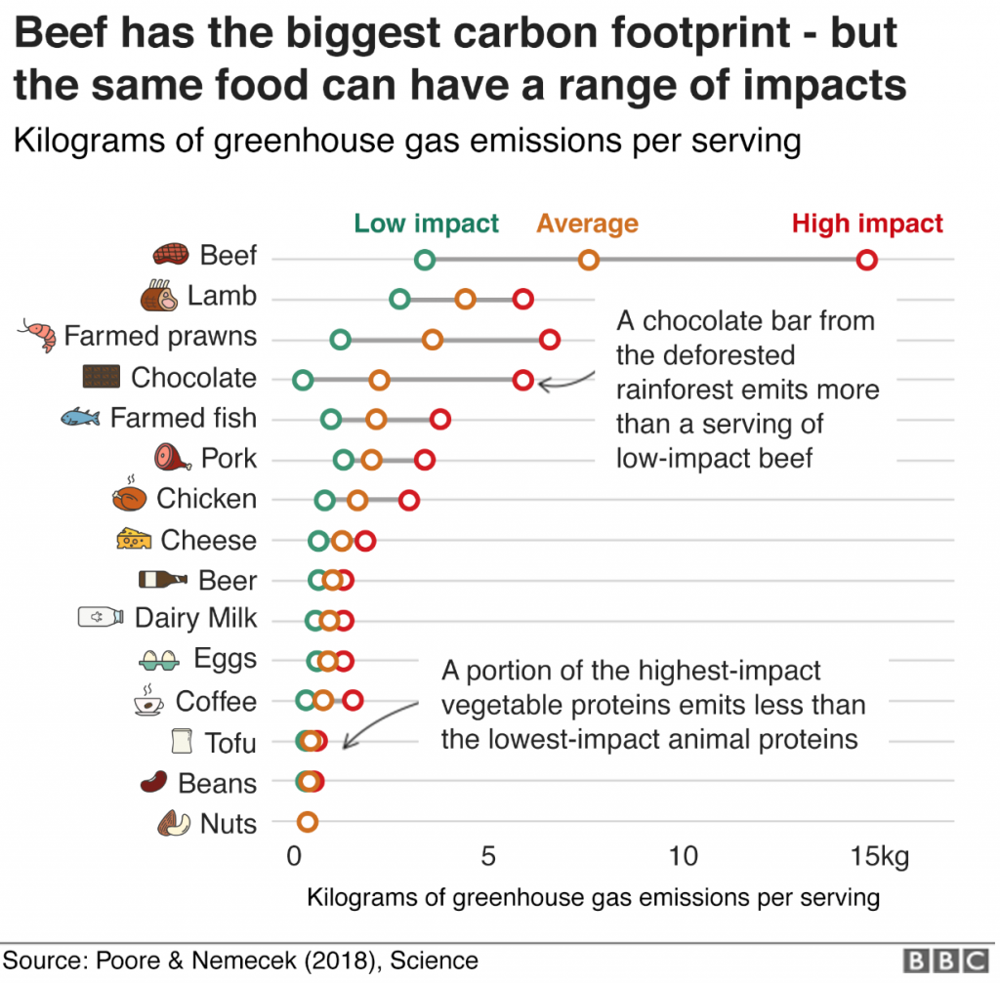

A new study from Poore & Nemecek shows the carbon footprint of our diet. BBC’s has made a tool, where you can check the [carbon footprint calculator](https://www.bbc.com/news/science-environment-46459714) for what you eat. Not surprisingly, reducing meat and diary products reduces your environmental impact most ([Poore & Nemecek, Science, 2018](https://science.sciencemag.org/content/360/6392/987)).

<figure class="wp-block-image">

</figure>
