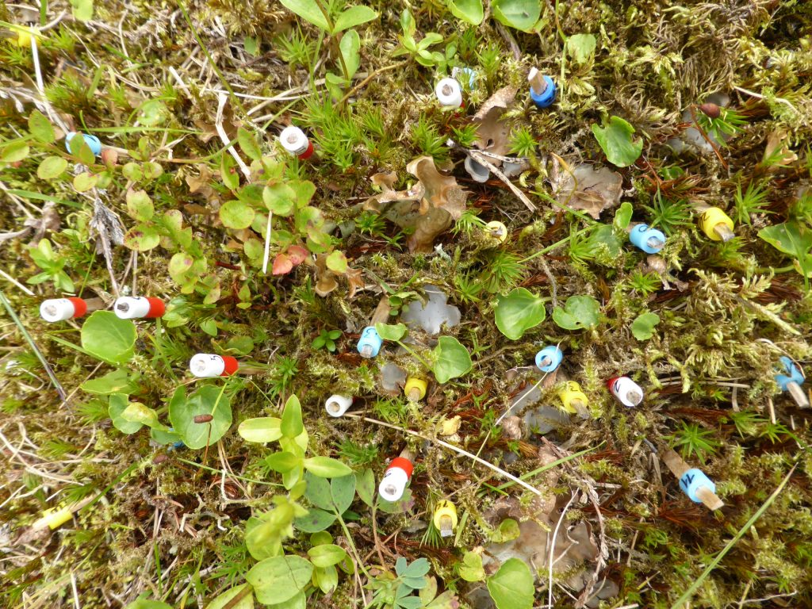

### [The devil is in the detail: Nonadditive and context‐dependent plant population responses to increasing temperature and precipitation](https://doi.org/10.1111/gcb.14336)

<a href="https://onlinelibrary.wiley.com/action/doSearch?ContribAuthorStored=T%C3%B6pper%2C+Joachim+P" id="a1_Ctrl" class="author-name accordion-tabbed__control" data-id="a1" data-db-target-for="a1" aria-controls="a1" aria-haspopup="true">Joachim P. Töpper</a> , <a href="https://onlinelibrary.wiley.com/action/doSearch?ContribAuthorStored=Meineri%2C+Eric" id="a2_Ctrl" class="author-name accordion-tabbed__control" data-id="a2" data-db-target-for="a2" aria-controls="a2" aria-haspopup="true">Eric Meineri</a> , <a href="https://onlinelibrary.wiley.com/action/doSearch?ContribAuthorStored=Olsen%2C+Siri+L" id="a3_Ctrl" class="author-name accordion-tabbed__control" data-id="a3" data-db-target-for="a3" aria-controls="a3" aria-haspopup="true">Siri L. Olsen</a> , <a href="https://onlinelibrary.wiley.com/action/doSearch?ContribAuthorStored=Rydgren%2C+Knut" id="a4_Ctrl" class="author-name accordion-tabbed__control" data-id="a4" data-db-target-for="a4" aria-controls="a4" aria-haspopup="true">Knut Rydgren</a> , <a href="https://onlinelibrary.wiley.com/action/doSearch?ContribAuthorStored=Skarpaas%2C+Olav" id="a5_Ctrl" class="author-name accordion-tabbed__control" data-id="a5" data-db-target-for="a5" aria-controls="a5" aria-haspopup="true">Olav Skarpaas</a> , <a href="https://onlinelibrary.wiley.com/action/doSearch?ContribAuthorStored=Vandvik%2C+Vigdis" id="a6_Ctrl" class="author-name accordion-tabbed__control" data-id="a6" data-db-target-for="a6" aria-controls="a6" aria-haspopup="true">Vigdis Vandvik</a>

## 

Plants marked with toothpicks for demographic study. Picture: Siri Lie Olsen

In climate change ecology, simplistic research approaches may yield unrealistically simplistic answers to often more complicated problems. In particular, the complexity of vegetation responses to global climate change begs a better understanding of the impacts of concomitant changes in several climatic drivers, how these impacts vary across different climatic contexts, and of the demographic processes underlying population changes. Using a replicated, factorial, whole‐community transplant experiment, we investigated regional variation in demographic responses of plant populations to increased temperature and/or precipitation. Across four perennial forb species and 12 sites, we found strong responses to both temperature and precipitation change. Changes in population growth rates were mainly due to changes in survival and clonality. In three of the four study species, the combined increase in temperature and precipitation reflected nonadditive, antagonistic interactions of the single climatic changes for population growth rate and survival, while the interactions were additive and synergistic for clonality. This disparity affects the persistence of genotypes, but also suggests that the mechanisms behind the responses of the vital rates differ. In addition, survival effects varied systematically with climatic context, with wetter and warmer + wetter transplants showing less positive or more negative responses at warmer sites. The detailed demographic approach yields important mechanistic insights into how concomitant changes in temperature and precipitation affect plants, which makes our results generalizable beyond the four study species. Our comprehensive study design illustrates the power of replicated field experiments in disentangling the complex relationships and patterns that govern climate change impacts across real‐world species and landscapes.

