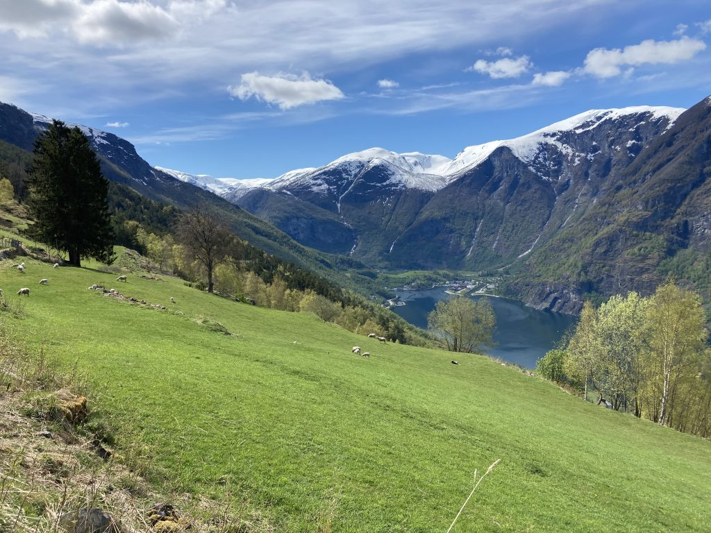
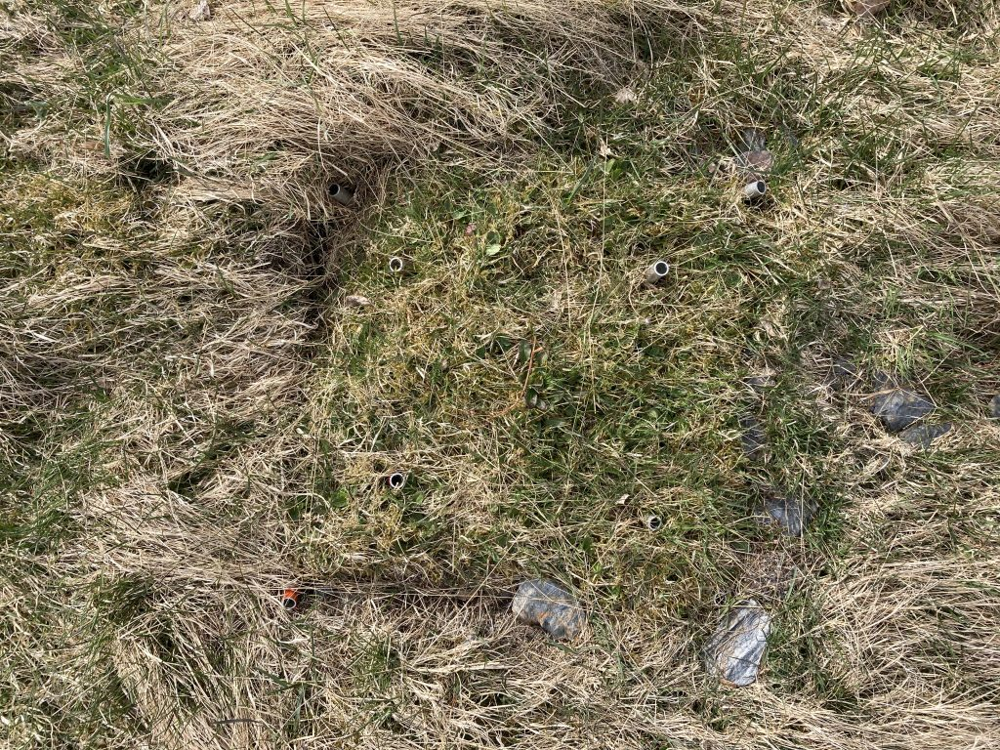
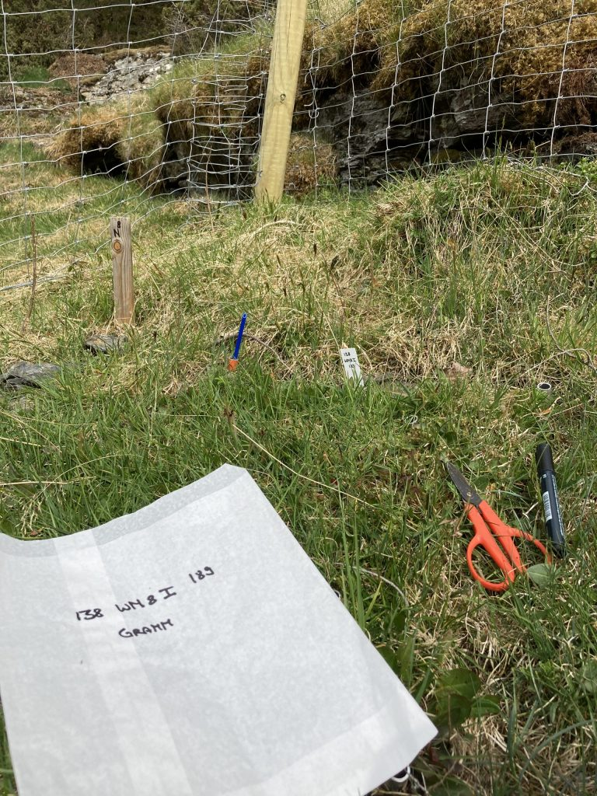
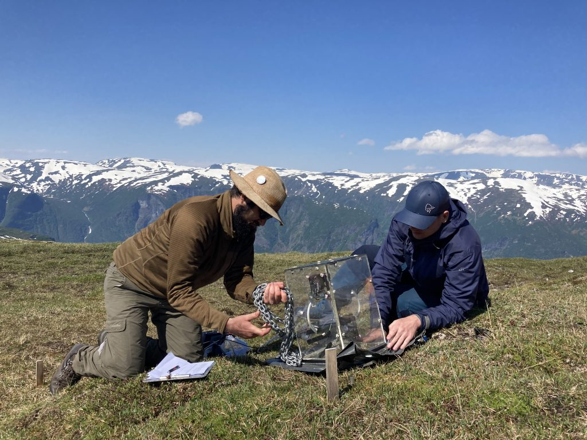
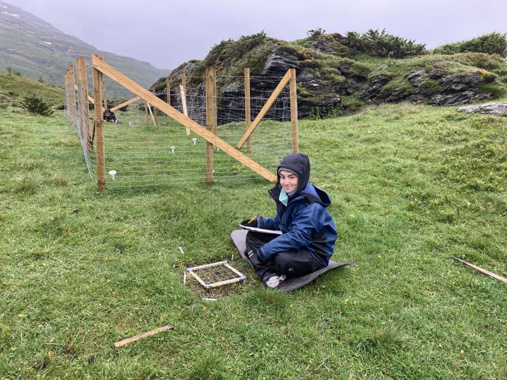
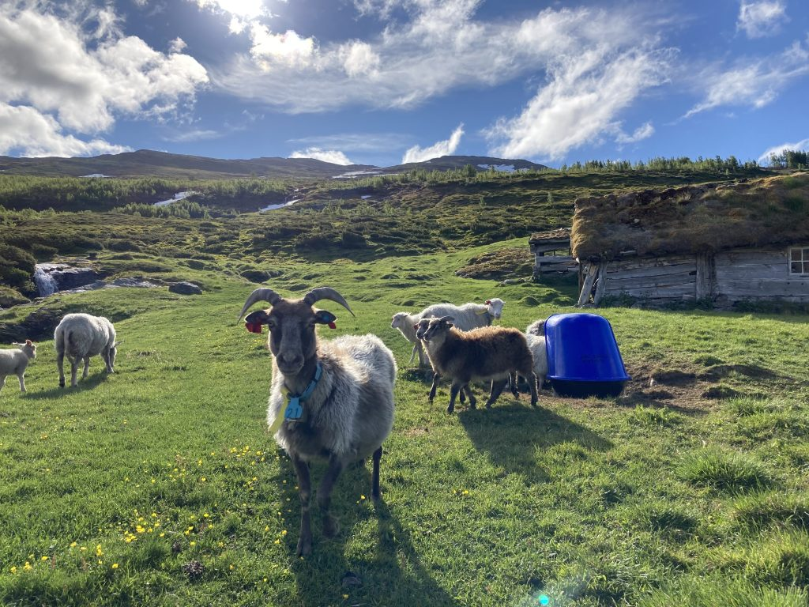

Field work is always the busy season for plant ecologists. We maintain the experiments, collect new data, deal with unexpected situations and issues, and try to cramp in as much work as possible into a few weeks. Due to the Corona situation this year, the field season was uncertain for a long time and it was unclear if we could do the work at all. Slowly, we made plans for what was essential and things that could be dropped.

Three-D field sites are located in the beautiful fjord landscape, with large gradients from sea level to the alpine.

For the Three-D project the most important thing was to keep the experiment running. This meant, building fences around the plots that were established last year and to apply the treatments. The treatments in this project are warmer climate by transplants (so nothing to do there), nitrogen addition and clipping (simulate grazing). The first problem was to order a slow release nitrogen fertilizer. I contacted some colleagues from [Nutnet](https://nutnet.org/) (Nutrient Network) and they kindly helped me out with advice. I finally managed to order 600kg of fertilizer. The last treatment is a clipping treatment, where we simulate different levels of grazing. For this, we are clipping and removing the vegetation in the plots 2-4 times during the growing season.

A transplanted plot at the beginning of the field season.

We clip the vegetation with scissors and sort them into different functional groups.

For the measurements, we are interested in change in plant community and ecosystem function in response to warming, nitrogen and grazing. For this, we record presence/absence and cover of all vascular plants and carbon fluxes. We decided to reduce these measurements to a minimum, only on the controlled and warmed plots.

Joseph and Alex measuring carbon fluxes using a Licor and a plexiglas chamber.

Leire, our IAESTE intern from Spain, recording functional group cover.

So far the field work has been going well and the experiment looks good. The plants are responding to the treatments and we have collected all the data we wanted. We are also taking other measures to keep the people save. We follow strict hygiene rules, work in small groups, and try not to mix the people. We are very grateful that nobody has gotten sick yet.

Sheep grazing at Joasete.

