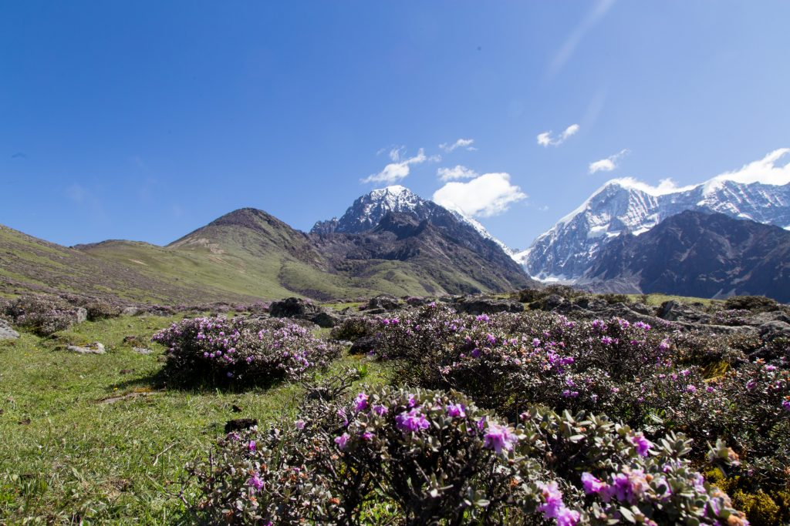

In the last two weeks I have travelled around the world (yes, I had to write this line) to select sites for the Three-D project in China and in Norway. We have successfully selected beautiful, species rich, and semi-natural grasslands along elevational gradients.

In each country we selected 3 sites along a productivity gradient. The gradient in Norway starts at 500m and stretches up to 1300m. In China, the lowest site is located at 3500m and the highest site at 4300m. The highest sites are low productive.

Both systems are grazed by somewhat different animals. In Norway, there are mainly sheep and goats, while in China, the dominant grazers are horses and yak.

The next step will be to select the plots and blocks and set up fences.

<figure class="wp-block-image">

</figure>

<figure class="wp-block-image">

</figure>
