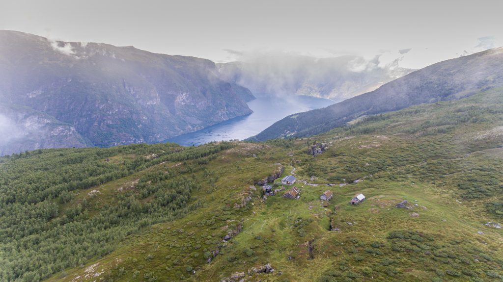
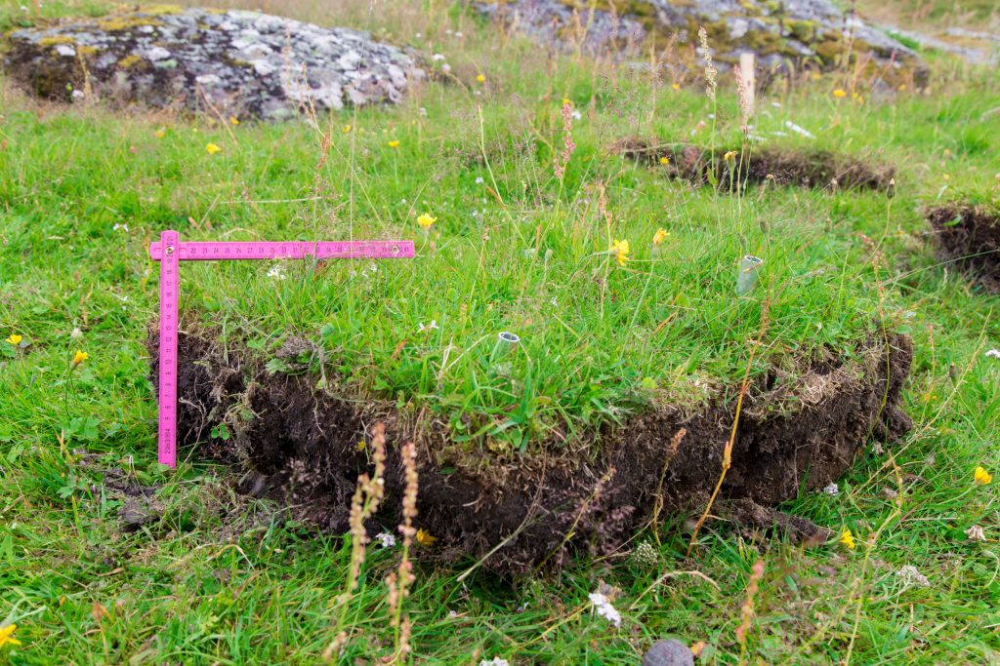
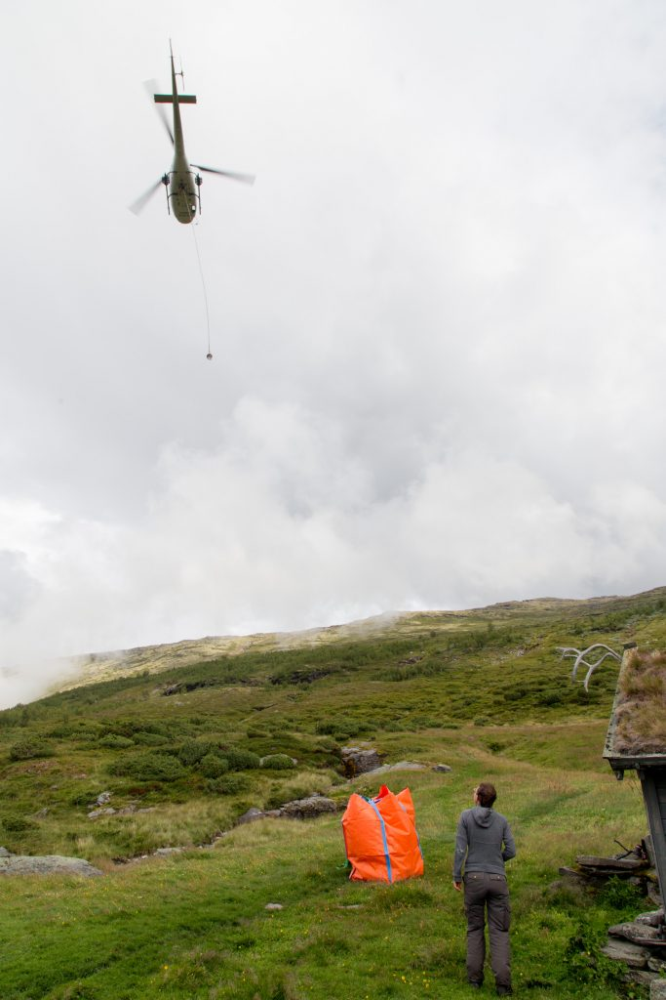
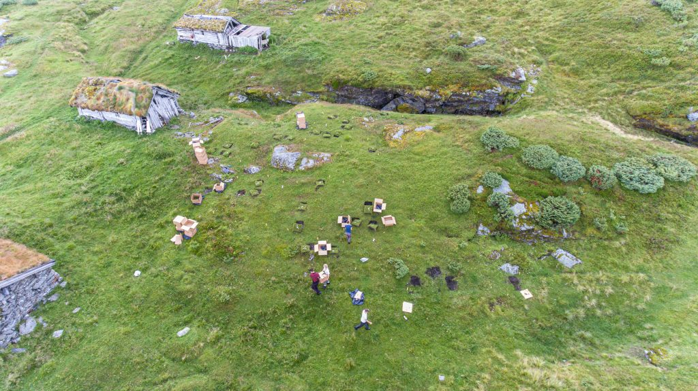
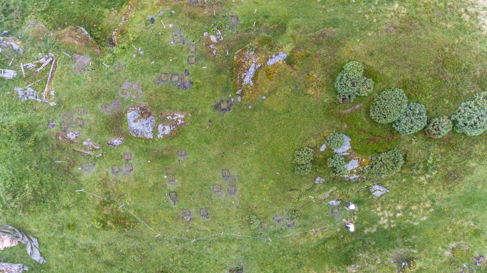

<figure class="wp-block-image">

</figure>

This summer has passed quickly with lot’s of field work setting up the Three-D project. We have selected plots, recorded vegetation and taken soil samples. The weather has been fantastic to do all the work this year (a bit unusual for Western Norway).

This week, we transplanted vegetation turfs from the mountain to lower elevation, which is part of the warmer climate treatment. From each site, we dug out 40 turfs (50 x 50 cm), put them in boxes and transported them 400m down the mountain, where they were put back into the ground. Each turf weighed between 10 – 30 kg and the 80 turfs must have added up to c. 2 tons. Luckily, we did not have to carry the turfs ourselves, we used a helicopter.

<figure class="wp-block-image">

</figure>

<figure class="wp-block-image">

</figure>

The organization of the transplanting has been a logistic nightmare and I am very glad it is done now. The helicopter cannot fly in fog or when there are strong winds. And I needed many helpers to dig out, be in several locations at the same time, coordinate the helicopter, put the turfs back into the soil.

Thanks again Josh, Vincent, Frida and Kevin for your hard work and high spirits! And thanks Kevin for filming, droning and taking nice shots!

<figure class="wp-block-image">

</figure>

<figure class="wp-block-image">

</figure>
