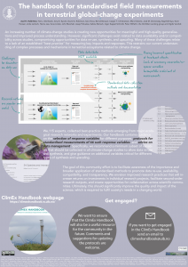

I was supposed to go to a conference next week; the EGU in Vienna. But I am not going to the conference now, as almost no travelling, meetings and going to work is happening at the moment. The conference is still happening, but everything is going to be online.  
I made a [poster](https://meetingorganizer.copernicus.org/egu2020/meetingprogramme) to present the [ClimEx Handbook](https://climexhandbook.w.uib.no/) and hope for fruitful discussions during our sessions. Come and visit our session:

BG2.23 [Whole system approaches in addressing processes and long-term changes in terrestrial and aquatic ecosystems](https://meetingorganizer.copernicus.org/EGU2020/session/35273)

