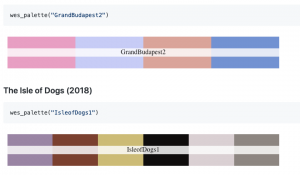

Do you also love Wes Anderson movies? Today, I learnt that there are [Wes Anderson colour palettes](https://github.com/karthik/wesanderson) for R. So from now on you can colour your ggplots according to Rushmore, The Grand Budapest Hotel or The Isle of Dogs.

