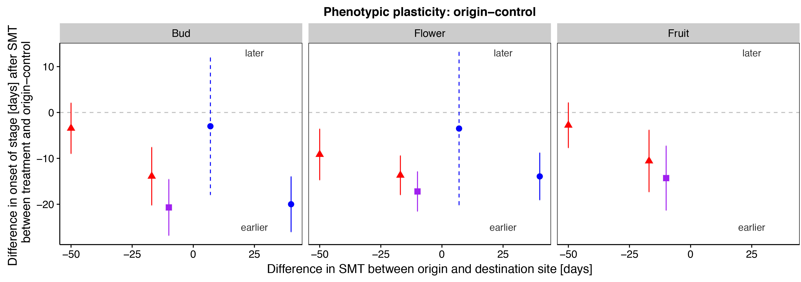
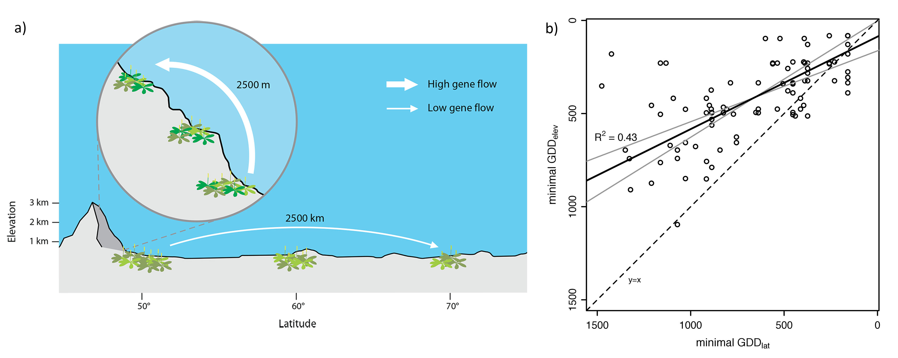
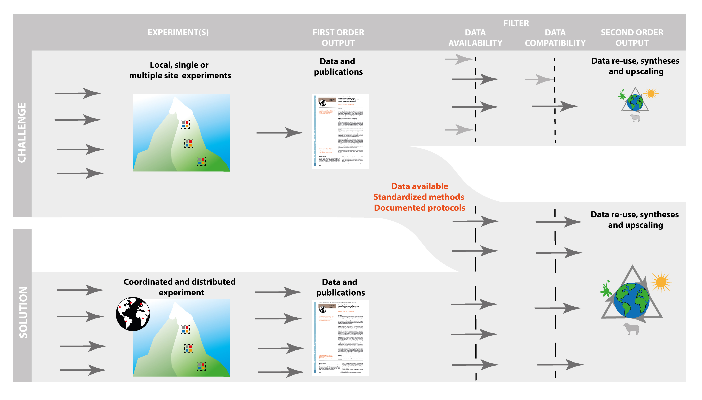

## Projects

- [THREE-D](research/three-d.qmd) — warming, nitrogen deposition, and grazing in alpine grasslands.
- [NatuRA](research/natura.qmd) — sustainable use of mountain grasslands in Norway and South Africa.

## Climate change, evolution, and traits

My research combines climate change, evolutionary, and trait-based ecology to improve understanding of how alpine plant communities adapt to environmental change. I have documented local adaptation to harsh alpine conditions, and also decreased phenotypic plasticity at high elevation. That combination can matter for how populations tolerate environmental change. Range-edge populations at the limit of a species' distribution performed badly under warmer climatic conditions, potentially because reduced phenotypic plasticity is costly in a harsh environment (Delnevo et al. 2018, Davy 2018). This implies high sensitivity to climate change, especially at high elevation.

Quantifying inter- and intraspecific trait variation, and the plasticity of leaf traits, helps explain how plant species persist under climate change. Leaf trait plasticity is an important mechanism for staying in a community and tolerating new conditions (Henn et al. 2018).

Combining ecological, evolutionary, and trait-based approaches makes it possible to separate community responses, and their effects on ecosystem function, across broad biogeographical gradients.

## Gradients and interacting global-change drivers

Several processes, including dispersal limitation and population or evolutionary dynamics, interact to set species range margins. Understanding those processes is what makes it possible to predict responses to climate change. I use observations and experiments along environmental gradients, which stand in for future climate conditions. Elevational and latitudinal gradients cover a similar range of temperature, but they differ in spatial scale.

In a field survey, species reached lower temperature limits along the elevational gradient than along the latitudinal gradient (Halbritter et al. 2013). A reciprocal transplant of two *Plantago* species, using plants from the centre of the European range and from latitudinal and elevational range edges, showed that range-centre plants of *P. major* were adapted to the centre but performed similarly to range-edge plants when grown at the edges. There was no evidence for local adaptation when central and edge populations of *P. lanceolata* were compared. Plants of both species from high elevation were locally adapted when compared with plants from high latitude, although the reverse was not true (Halbritter et al. 2015).

Replicated experiments along gradients show that species responses to climate change are strongly context-dependent. Populations from elevational range edges, but not from high-latitude range edges, were locally adapted (Halbritter et al. 2015). A likely reason is higher genetic variation and gene flow at the elevational edge, where populations are closer together.

## Synthesis across studies

Global change threatens biodiversity and ecosystem functioning, and a clearer picture of those impacts is still needed. Syntheses across studies are one way to see large-scale patterns and where the effects depend on context. The handbook for standardised field and laboratory methods in terrestrial global-change experiments (Halbritter et al. 2020) was written to make data from different experiments easier to combine, and so to make data reuse, synthesis, and upscaling more realistic. Data management — reproducibility, documentation, and open data — is part of that. Funders and publishers increasingly ask for data management plans and FAIR practice. I take part in this work through collaborations and networks such as ClimMani and the Open Traits network (Gallagher et al. 2020).

