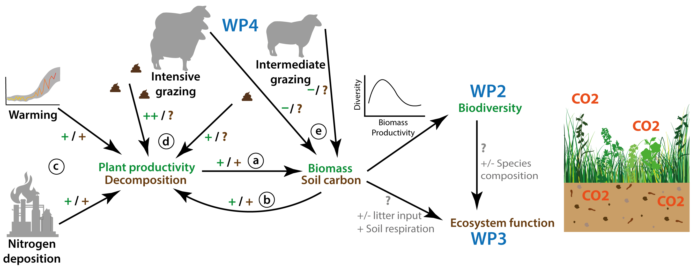
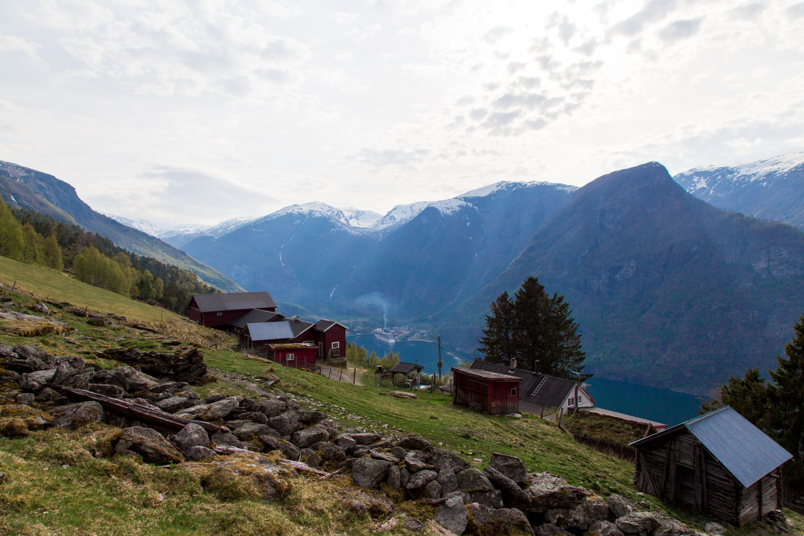

THREE-D is an integrated assessment of how to mitigate the negative impacts of three global-change drivers on alpine biodiversity and ecosystem function. I led the project (Research Council of Norway, MILJØFORSK 287801, 2019–2022).

Warming, nitrogen deposition, and grazing can all have complex effects on biodiversity and ecosystem function, and the biodiversity effects are often negative. For plant communities, these impacts operate through many of the same ecological pathways: changes in plant productivity and biomass, and in carbon cycling. THREE-D combined those pathways into one predictive framework, so the interactions can be assessed and, where possible, mitigated. Grazing is useful for that question because its effect on a community depends on productivity, and because it can be changed locally. That makes it possible to ask when grazing is itself a stress, and when it reduces the strain from warming or nitrogen deposition. The work is in alpine ecosystems because they are particularly exposed to global change.

The three drivers act at different spatial scales, from global to local, and over different lengths of time. They still meet in the same mechanisms: productivity, biomass, and the carbon cycle, with different consequences for biodiversity and for carbon fluxes.

Two questions:

1. How does grazing interact with climate warming and nitrogen deposition, and how does that affect biodiversity and ecosystem functioning in an alpine ecosystem?
2. When, and at what level, does grazing mitigate the effects of warming and nitrogen deposition on biodiversity and ecosystem functioning?

Parallel experiments in Norway and China exposed alpine plant communities to a warmer climate (transplant to lower elevation), added nitrogen, and different grazing levels, in a factorial design.

The hypotheses were:

- The effect of grazing on species composition along a productivity gradient runs from loss of facilitation in low-productivity communities to competitive release in high-productivity communities.
- A decline in species composition caused by warming or nitrogen deposition can be mitigated at an intermediate grazing level.
- Grazing stimulates overall ecosystem carbon fluxes at low productivity. At high productivity, the effect depends on decomposition, the change in carbon fluxes, and the change in species composition.
- Intermediate grazing can, to some degree, mitigate negative impacts of warming or nitrogen deposition on ecosystem carbon fluxes.

The project also set out to develop a management decision-support tool, with farmers and local conservation managers, to estimate the impact of the current grazing level and to explore whether a change in grazing could meet new pressures or support ecosystem services.

